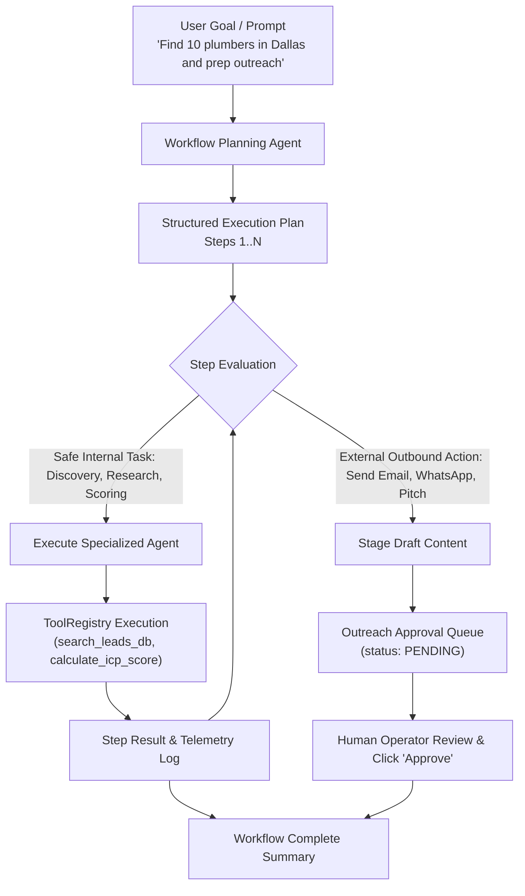

# AI Sales & CRM Operating System — AI Agent Architecture & Documentation

## 1. Multi-Agent System Overview

The AI Sales & CRM Operating System incorporates a modular, multi-agent AI architecture comprising **15 Specialized AI Agents** overseen by the **Master AI Orchestrator** (`AIOrchestrator`). 

Unlike monolithic LLM chatbots, each agent is constrained to a specific sales domain, possesses bounded tool access via a strictly scoped `ToolRegistry`, adheres to typed JSON input/output schemas, and is governed by system execution limits to prevent infinite recursion, token depletion, or unintended external actions.

### Core Governance Principles
1. **Scoped Tool Execution**: Agents can only execute tools explicitly whitelisted in their `allowed_tools` definition. Calls to unregistered tools or tools outside the agent's scope are blocked.
2. **Tool Execution Limits**: Agents are restricted to a maximum of 10 tool iterations per prompt (`max_execution_steps = 10`).
3. **Automated Provider Fallback**: Agents automatically run on Google Gemini Flash, failing over to OpenRouter, and ultimately falling back to `HeuristicAIProvider` if API keys are missing or offline.
4. **Mandatory Human-in-the-Loop Gateway**: Whenever an agent generates an outreach message, campaign touchpoint, or external communication, the orchestrator automatically intercepts the action and queues it in the `outreach_approvals` table (`PENDING`) for human review.

---

## 2. Master AI Orchestration Engine (`AIOrchestrator`)

The `AIOrchestrator` (`backend/app/ai/orchestrator/orchestrator.py`) manages autonomous multi-agent workflows.



### Telemetry & Audit Tracking
Every agent execution automatically creates a record in `agent_runs` logging:
- `agent_name`: Specialized agent invoked
- `provider_used`: Provider selected by fallback chain (`gemini`, `openrouter`, or `heuristic`)
- `model_name`: Specific model checkpoint
- `execution_time_ms`: Millisecond latency
- `tools_called`: Structured JSON array of tools and arguments
- `status`: `success`, `error`, or `fallback`

---

## 3. Directory of the 15 Specialized AI Agents

### Agent 1: `lead_discovery_agent`
- **Specialty Role**: Lead Discovery Specialist
- **Mission**: Formulates high-intent search queries, geo-coordinates, and commercial categories to maximize lead yield across maps and directories.
- **Allowed Tools**: `search_leads_db`
- **Input Schema**:
  ```json
  {
    "query": "string (e.g. 'commercial electrical contractors')",
    "location": "string (e.g. 'Austin, TX')",
    "target_icp": "string (optional ICP guidelines)"
  }
  ```
- **Output Schema**:
  ```json
  {
    "recommended_queries": ["string"],
    "target_categories": ["string"],
    "search_radius_km": 15,
    "discovery_strategy": "string"
  }
  ```

---

### Agent 2: `company_research_agent`
- **Specialty Role**: Company Intelligence Analyst
- **Mission**: Ingests scraped website HTML, metadata, and directory listings to construct an intelligence dossier with strict truth separation (`verified_facts`, `inferred_insights`, `unknowns`).
- **Allowed Tools**: `search_leads_db`
- **Input Schema**:
  ```json
  {
    "lead_id": "string (UUID)",
    "company_name": "string",
    "website": "string",
    "raw_text": "string (scraped body text)"
  }
  ```
- **Output Schema**:
  ```json
  {
    "verified_facts": {
      "company_name": "string",
      "address": "string",
      "verified_contacts": ["string"],
      "detected_technologies": ["string"]
    },
    "inferred_insights": {
      "business_model": "string",
      "potential_pain_points": ["string"],
      "suggested_offering": "string"
    },
    "unknowns": ["string"]
  }
  ```

---

### Agent 3: `contact_enrichment_agent`
- **Specialty Role**: Contact Enrichment Specialist
- **Mission**: Analyzes website text and employee rosters to extract executive decision-makers, email formats, and reachability statuses.
- **Allowed Tools**: `search_leads_db`
- **Input Schema**:
  ```json
  {
    "company_name": "string",
    "text": "string (scraped 'About Us' or team page text)"
  }
  ```
- **Output Schema**:
  ```json
  {
    "key_people": [
      { "name": "string", "title": "string", "relevance": "High|Medium" }
    ],
    "contact_channels": [
      { "channel": "EMAIL|PHONE", "value": "string", "confidence": "High|Medium" }
    ],
    "reachability_rating": "High|Medium|Low",
    "enrichment_summary": "string"
  }
  ```

---

### Agent 4: `lead_qualification_agent`
- **Specialty Role**: Lead Qualification Specialist
- **Mission**: Evaluates prospective businesses against 5 configurable ICP criteria (fit, pain, timing, reachability, evidence) generating a composite 0–100 score and recommendation.
- **Allowed Tools**: `calculate_icp_score`, `search_leads_db`
- **Input Schema**:
  ```json
  {
    "lead_id": "string (UUID)",
    "icp_profile": "string (optional specific ICP description)",
    "weights": {
      "icp_fit": 0.25,
      "pain_points": 0.25,
      "timing_intent": 0.20,
      "reachability": 0.15,
      "evidence_quality": 0.15
    }
  }
  ```
- **Output Schema**:
  ```json
  {
    "qualification_score": 88.5,
    "qualification_status": "Qualified|Maybe|Rejected",
    "reasoning": "string",
    "breakdown": {
      "icp_fit": 22.0,
      "pain_points": 24.0,
      "timing_intent": 18.0,
      "reachability": 12.0,
      "evidence_quality": 12.5
    },
    "recommended_action": "string"
  }
  ```

---

### Agent 5: `icp_analysis_agent`
- **Specialty Role**: ICP Strategist
- **Mission**: Analyzes historical won deals and market descriptions to refine ideal customer profile parameters, qualifying triggers, and hard disqualifiers.
- **Allowed Tools**: `query_crm_pipeline`
- **Input Schema**:
  ```json
  {
    "service_offering": "string",
    "target_market": "string"
  }
  ```
- **Output Schema**:
  ```json
  {
    "icp_summary": "string",
    "target_industries": ["string"],
    "company_size_sweet_spot": "string",
    "qualifying_triggers": ["string"],
    "disqualifiers": ["string"],
    "target_personas": ["string"]
  }
  ```

---

### Agent 6: `competitor_research_agent`
- **Specialty Role**: Market & Competitor Analyst
- **Mission**: Analyzes competitors in a target vertical and builds sales battlecards and objection-handling rebuttals.
- **Allowed Tools**: `search_leads_db`
- **Input Schema**:
  ```json
  {
    "industry_or_category": "string (e.g. 'Inbound Dental Marketing')"
  }
  ```
- **Output Schema**:
  ```json
  {
    "market_category": "string",
    "common_competitor_gaps": ["string"],
    "our_key_differentiators": ["string"],
    "objection_battlecard": [
      { "competitor_type": "string", "our_counter_angle": "string" }
    ]
  }
  ```

---

### Agent 7: `outreach_strategy_agent`
- **Specialty Role**: Outreach Strategist
- **Mission**: Designs high-converting, compliant multi-touch sequences across Email and WhatsApp.
- **Allowed Tools**: `query_crm_pipeline`
- **Input Schema**:
  ```json
  {
    "audience": "string",
    "channel": "EMAIL|WHATSAPP|MULTICHANNEL"
  }
  ```
- **Output Schema**:
  ```json
  {
    "campaign_theme": "string",
    "recommended_cadence": "string",
    "steps": [
      {
        "step_number": 1,
        "delay_days": 0,
        "subject_line": "string",
        "intent": "string"
      }
    ]
  }
  ```

---

### Agent 8: `email_personalization_agent`
- **Specialty Role**: Outreach Personalization Specialist
- **Mission**: Drafts hyper-tailored cold outreach emails under 120 words incorporating verified facts and customer pain points.
- **Allowed Tools**: `search_leads_db`, `query_crm_pipeline`
- **Input Schema**:
  ```json
  {
    "company_name": "string",
    "contact_name": "string",
    "pain_points": ["string"],
    "offering": "string",
    "verified_facts": ["string"]
  }
  ```
- **Output Schema**:
  ```json
  {
    "subject_line": "string",
    "email_body": "string",
    "personalization_reason": "string",
    "call_to_action": "string"
  }
  ```

---

### Agent 9: `followup_planning_agent`
- **Specialty Role**: Follow-up Cadence Planner
- **Mission**: Produces non-intrusive follow-up messages referencing previous context and elapsed time.
- **Allowed Tools**: `query_crm_pipeline`
- **Input Schema**:
  ```json
  {
    "company_name": "string",
    "previous_subject": "string",
    "days_since": 4
  }
  ```
- **Output Schema**:
  ```json
  {
    "followup_subject": "string",
    "followup_body": "string",
    "suggested_send_timing": "string"
  }
  ```

---

### Agent 10: `reply_classification_agent`
- **Specialty Role**: Inbound Reply Classifier
- **Mission**: Categorizes inbound prospect responses (`INTERESTED`, `OBJECTION`, `NOT_NOW`, `UNSUBSCRIBE`, `QUESTION`, `OUT_OF_OFFICE`) and drafts response proposals.
- **Allowed Tools**: None (pure NLP classification)
- **Input Schema**:
  ```json
  {
    "reply_text": "string",
    "company_name": "string"
  }
  ```
- **Output Schema**:
  ```json
  {
    "classification": "INTERESTED|OBJECTION|NOT_NOW|UNSUBSCRIBE|QUESTION|OUT_OF_OFFICE",
    "sentiment": "Positive|Neutral|Negative",
    "suggested_reply": "string",
    "requires_human_attention": true
  }
  ```

---

### Agent 11: `crm_management_agent`
- **Specialty Role**: CRM Operations Manager
- **Mission**: Inspects active deals, detects stale or neglected opportunities, and suggests hygiene updates and tasks.
- **Allowed Tools**: `query_crm_pipeline`
- **Input Schema**:
  ```json
  {}
  ```
- **Output Schema**:
  ```json
  {
    "pipeline_health_status": "Healthy|Needs Attention|Critical",
    "recommended_actions": ["string"],
    "followup_recommendations": [
      { "deal_title": "string", "recommended_action": "string" }
    ]
  }
  ```

---

### Agent 12: `meeting_preparation_agent`
- **Specialty Role**: Executive Meeting Prep Specialist
- **Mission**: Synthesizes pre-call briefing dossiers, discovery questions, and objection handling for upcoming sales appointments.
- **Allowed Tools**: `query_crm_pipeline`, `search_leads_db`
- **Input Schema**:
  ```json
  {
    "meeting_title": "string",
    "company_name": "string",
    "company_context": "string"
  }
  ```
- **Output Schema**:
  ```json
  {
    "executive_summary": "string",
    "key_discovery_questions": ["string"],
    "potential_objections": ["string"],
    "desired_call_outcome": "string"
  }
  ```

---

### Agent 13: `sales_analytics_agent`
- **Specialty Role**: Sales Performance Analyst
- **Mission**: Calculates funnel velocity, qualification drop-off, won deal economics, and strategic growth advice.
- **Allowed Tools**: `query_crm_pipeline`
- **Input Schema**:
  ```json
  {}
  ```
- **Output Schema**:
  ```json
  {
    "metrics": {
      "total_leads": 120,
      "qualification_rate": "34.5%",
      "won_value": 45000.0,
      "open_pipeline_value": 115000.0
    },
    "analysis": {
      "performance_summary": "string",
      "identified_bottlenecks": ["string"],
      "strategic_recommendations": ["string"]
    }
  }
  ```

---

### Agent 14: `knowledge_retrieval_agent`
- **Specialty Role**: Knowledge Base & RAG Assistant
- **Mission**: Answers complex sales questions by semantically querying internal playbooks, offerings, and case study documents with source citations.
- **Allowed Tools**: `knowledge_retrieval`
- **Input Schema**:
  ```json
  {
    "query": "string (e.g. 'What is our standard implementation SLA?')"
  }
  ```
- **Output Schema**:
  ```json
  {
    "answer": "string",
    "source_citations": ["string"],
    "confidence": "High|Medium|Low"
  }
  ```

---

### Agent 15: `workflow_planning_agent`
- **Specialty Role**: Master Autonomous Workflow Planner
- **Mission**: Decomposes high-level sales objectives into structured, multi-agent execution steps with explicit approval gates.
- **Allowed Tools**: All Registered Tools
- **Input Schema**:
  ```json
  {
    "request": "string (e.g. 'Discover 15 commercial landscapers, score them, and queue outreach')"
  }
  ```
- **Output Schema**:
  ```json
  {
    "workflow_name": "string",
    "total_steps": 3,
    "steps": [
      {
        "step_number": 1,
        "agent": "lead_discovery_agent",
        "action_description": "string",
        "requires_human_approval": false
      },
      {
        "step_number": 2,
        "agent": "lead_qualification_agent",
        "action_description": "string",
        "requires_human_approval": false
      },
      {
        "step_number": 3,
        "agent": "email_personalization_agent",
        "action_description": "string",
        "requires_human_approval": true
      }
    ],
    "estimated_duration_seconds": 45
  }
  ```

---

## 4. Scoped Tool Registry (`ToolRegistry`)

Tools represent deterministic, read-only or transactional actions that agents can call:

| Tool Name | Parameters | Returns | Security / Limits |
| :--- | :--- | :--- | :--- |
| `search_leads_db` | `query` (str), `limit` (int) | List of matching leads from database | Read-only. Max limit 50. |
| `query_crm_pipeline`| None | Snapshot of pipelines, stages, and deal counts | Read-only aggregation. |
| `calculate_icp_score`| `lead_id` (str), `weights` (dict) | Evaluated score, status, and breakdown | Deterministic calculation. Updates lead record. |
| `knowledge_retrieval`| `query` (str), `top_k` (int) | Ranked document chunks with embeddings | Read-only semantic search. |
