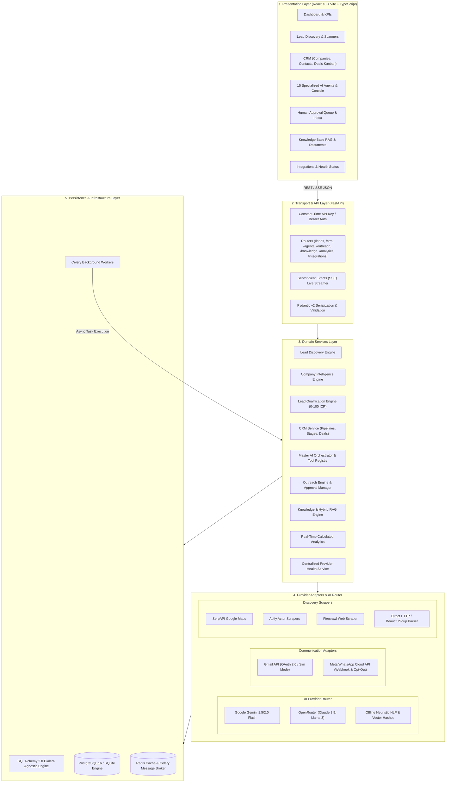
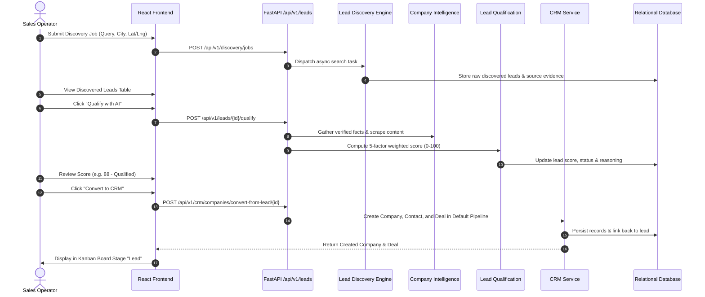
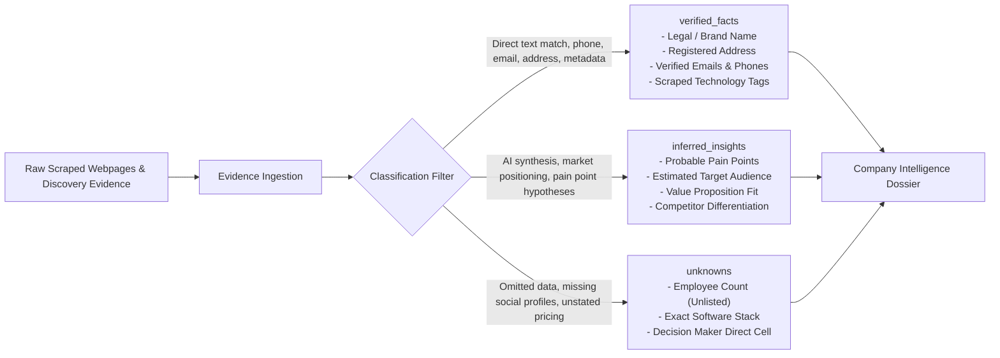
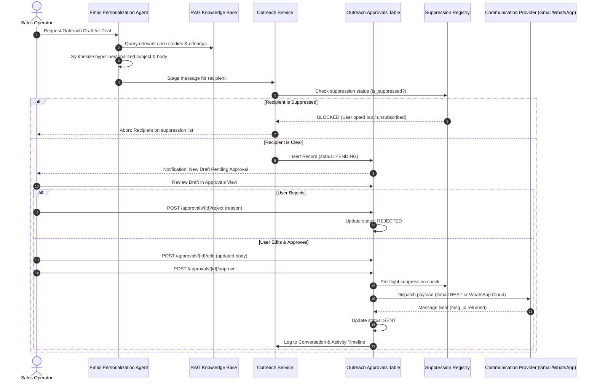

# AI Sales & CRM Operating System — System Architecture

## 1. Architectural Overview

The **AI Sales & CRM Operating System** is an autonomous, fault-tolerant, single-user platform engineered to transform raw business discovery signals into closed customer relationships. The platform pairs high-throughput multi-source lead scraping and company intelligence with a relational CRM, a multi-agent AI reasoning engine, a hybrid vector/lexical RAG knowledge base, and an enforced Human-in-the-Loop outreach queue.

### Core Architectural Principles
1. **Zero-Crash Resilience**: System operations never crash due to missing, expired, or rate-limited third-party credentials (Gemini, OpenRouter, SerpAPI, Apify, Firecrawl, Gmail, WhatsApp). Centralized health state tracking and automated offline fallback heuristics ensure 100% operational continuity.
2. **Strict Truth Separation**: Information synthesized by the AI Company Intelligence Engine is strictly partitioned into `verified_facts` (ground truth extracted directly from crawl evidence), `inferred_insights` (AI hypotheses), and `unknowns` (missing discovery signals). AI hallucinations are never stored or presented as verified facts.
3. **Mandatory Human-in-the-Loop Outreach**: AI agents formulate personalized multi-channel outreach strategies, subject lines, and draft bodies, but outbound communication can **never** be dispatched autonomously. All outbound actions are staged in a persistent approval queue requiring explicit human authorization (`Approve & Send`, `Edit`, or `Reject`).
4. **Dialect-Agnostic Storage**: SQLAlchemy 2.0 architecture supports production-grade PostgreSQL 16 with pre-ping connection pooling, while gracefully running on SQLite (`crm_leads.db` / `test.db`) in local developer and air-gapped test environments without pool keyword errors.
5. **Decoupled 5-Layer Design**: Clean separation of Presentation, Transport, Domain Services, Provider Adapters, and Storage engines.

---

## 2. 5-Layer Decoupled Architecture

---

## 3. Component Interaction & Workflow Lifecycles

### 3.1. Lead Discovery to CRM Pipeline Flow

### 3.2. Company Intelligence & Strict Truth Separation

To prevent hallucinated data from contaminating business decisions, the `CompanyIntelligenceService` enforces structural validation:

### 3.3. Configurable AI Lead Qualification Engine

Leads are qualified deterministically or via AI using configurable weight factors stored in system configuration:
$$\text{Score} = w_{\text{fit}} \cdot S_{\text{fit}} + w_{\text{pain}} \cdot S_{\text{pain}} + w_{\text{timing}} \cdot S_{\text{timing}} + w_{\text{reach}} \cdot S_{\text{reach}} + w_{\text{evidence}} \cdot S_{\text{evidence}}$$

Default Factory Weights:
- **ICP Fit** ($w_{\text{fit}}$): 25% (Industry match, business model, geographic relevance)
- **Business Pain** ($w_{\text{pain}}$): 25% (Presence of challenges our services solve)
- **Timing & Intent** ($w_{\text{timing}}$): 20% (Recent hiring, website changes, expansions)
- **Contact Reachability** ($w_{\text{reach}}$): 15% (Verified email, phone, LinkedIn presence)
- **Evidence Quality** ($w_{\text{evidence}}$): 15% (Multi-source verification, active website)

**Manual Feedback Loop**: Operators can manually adjust lead scores and qualification statuses via `POST /api/v1/leads/{id}/feedback`. Every adjustment is permanently recorded in the `audit_logs` table with the previous score, new score, reasoning, and operator timestamp.

---

### 3.4. Outreach Engine & Human Approval Queue Safeguard

---

### 3.5. Knowledge Base & Hybrid RAG Retrieval

The system ingests internal sales playbooks, company capabilities, pricing sheets, and past case studies to supply context to agents:

1. **Document Ingestion**:
   - Documents are uploaded or created in `knowledge_documents`.
   - Chunked into segments of 600 characters with 100 character sliding overlap in `knowledge_chunks`.
   - Embedding generated via configured AI provider (or 128-dimensional offline character frequency hashing vector if keys are omitted).
2. **Hybrid Retrieval**:
   - **Vector Search**: Cosine similarity between query embedding and chunk embeddings:
     $$\text{CosineSimilarity}(\vec{u}, \vec{v}) = \frac{\vec{u} \cdot \vec{v}}{\|\vec{u}\| \|\vec{v}\|}$$
   - **Lexical Keyword Fallback**: SQL ILIKE / full-text token matching across chunks.
   - Merged and ranked with source document citations returned directly to the requesting agent.

---

## 4. Multi-Agent Orchestration & Scoped Tool Architecture

The platform houses **15 Specialized AI Agents** coordinated by an `AIOrchestrator`:

| Agent Name | Primary Specialty | Scoped Tools |
| :--- | :--- | :--- |
| `lead_discovery_agent` | Search query formulation & geo-targeting | `search_leads_db` |
| `company_research_agent` | Deep digital footprint & pain point synthesis | `search_leads_db` |
| `contact_enrichment_agent` | Executive persona extraction & reachability | `search_leads_db` |
| `lead_qualification_agent` | 5-factor weighted ICP score calculation | `calculate_icp_score`, `search_leads_db` |
| `icp_analysis_agent` | Target audience criteria & disqualifiers | `query_crm_pipeline` |
| `competitor_research_agent` | Market positioning & battlecards | `search_leads_db` |
| `outreach_strategy_agent` | Multi-touch sequence cadence planning | `query_crm_pipeline` |
| `email_personalization_agent` | Tailored 1-on-1 cold outreach drafting | `search_leads_db`, `query_crm_pipeline` |
| `followup_planning_agent` | Contextual follow-up generation | `query_crm_pipeline` |
| `reply_classification_agent` | Inbound sentiment & intent categorization | None (pure NLP) |
| `crm_management_agent` | Pipeline hygiene & stale deal monitoring | `query_crm_pipeline` |
| `meeting_preparation_agent` | Executive pre-call briefing dossiers | `query_crm_pipeline`, `search_leads_db` |
| `sales_analytics_agent` | Conversion velocity & funnel diagnostics | `query_crm_pipeline` |
| `knowledge_retrieval_agent` | Sales playbook Q&A with citations | `knowledge_retrieval` |
| `workflow_planning_agent` | Multi-step autonomous plan decomposition | All Tools |

### Tool Execution Safety
Agents can only execute tools explicitly registered in `ToolRegistry`. Unregistered tool requests are rejected with structured error feedback. Tool execution limits (maximum 10 tool iterations per prompt) prevent circular looping or token depletion.

---

## 5. Resilience & Fault Tolerance Matrix

| Failure Mode | Detection Mechanism | Automated System Fallback |
| :--- | :--- | :--- |
| **Missing / Invalid Gemini Key** | `ProviderHealthService` probe or `HTTP 401/403` | Seamlessly reroutes to OpenRouter API. If OpenRouter is unconfigured, engages `HeuristicAIProvider` (deterministic scoring, heuristic outreach). UI displays `DEGRADED` status. |
| **Missing Google OAuth / Gmail Key** | Check `GMAIL_CLIENT_ID` / tokens | Switches `GmailProvider` to development simulation mode. Outreach approvals are simulated, logged, and tracked without breaking runtime execution. |
| **Missing WhatsApp Cloud Token** | Check `WHATSAPP_API_TOKEN` | Switches `WhatsAppProvider` to development simulation mode. Webhooks parse incoming payloads safely; outbound messages log simulated delivery. |
| **PostgreSQL Unreachable** | Connection timeout / ECONNREFUSED | `database.py` traps connection failure and instantiates SQLite (`crm_leads.db`). Connection pool keywords are omitted on SQLite to eliminate operational crashes. |
| **Redis / Celery Unavailable** | ConnectionRefused to `REDIS_URL` | Fast fallback mode allows critical transactional CRM and lead scoring operations to execute synchronously within FastAPI request lifecycle. |
| **Rate Limit / 429 Throttle** | HTTP Status 429 from third-party API | Exponential backoff (1s, 2s, 4s) with provider health state set to `RATE_LIMITED`. Subsequent requests route to alternate provider. |

---

## 6. Security Boundaries & Single-User Controls

1. **Authentication**: All `/api/v1/*` endpoints are protected by `verify_api_key` dependency. When `AUTH_ENABLED=True`, incoming requests must present `X-API-Key` or `Authorization: Bearer <key>` matching `ADMIN_API_KEY`.
2. **SSRF Protection**: Scraping requests validate target URLs against private IP blocks (`10.0.0.0/8`, `172.16.0.0/12`, `192.168.0.0/16`, `127.0.0.1`, `169.254.169.254`) preventing local subnet or cloud metadata server exfiltration.
3. **Data Protection**: API credentials and secrets are loaded strictly through environment variables. Passwords and tokens are never returned in cleartext API responses. Error logs are sanitized to prevent credential reflection.
