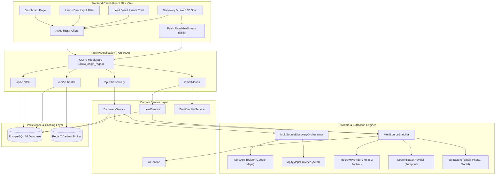
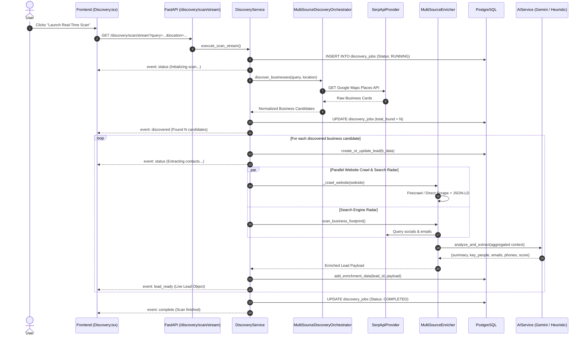
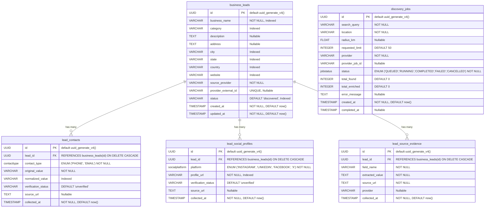
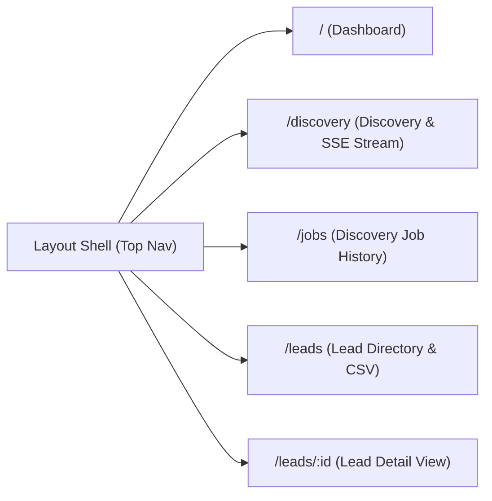
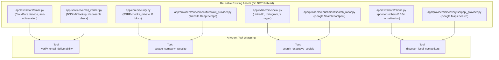

# Comprehensive Technical Codebase Audit & Architectural Analysis Report

**Project Name:** CRM Lead Generation & Discovery Engine  
**Target Goal:** Autonomous Sales & CRM Automation Platform with 50+ Specialized AI Agents  
**Auditor Role:** Senior Software Architect, Backend Engineer, AI Engineer, and Codebase Auditor  
**Audit Date:** November 2026  
**Repository Path:** `d:\MVP`  
**Report Artifact:** `CODEBASE_AUDIT_REPORT.md`  

---

## 1. Project Overview

### 1.1 Project Name & Purpose
The software system located at `d:\MVP` is a specialized **B2B Lead Discovery and Contact Intelligence Platform** named **CRM Lead Discovery** (internal package identifier: `crm-lead-discovery-frontend` and backend application title `CRM Lead Discovery`).

Its primary business purpose is discovering local and regional commercial businesses by domain/category, geographic coordinates, and city names; crawling their digital footprint; extracting multi-channel contact endpoints (telephones, verified email mailboxes, and social media URLs across LinkedIn, Instagram, Facebook, and X); and performing heuristic lead qualification scoring with audit trail provenance.

### 1.2 Current Business Functionality
The platform as implemented provides the following verified capabilities:
1. **Multi-Source Business Discovery**: Scrapes Google Maps and local business search engines using SerpAPI and Apify actors to return structured company candidate profiles.
2. **Deep Digital Footprint Enrichment**: Parallel crawling of official business websites via Firecrawl and direct fallback HTTP scrapers; extracts schema metadata (`application/ld+json`), contact pages, and about pages.
3. **Search Radar Footprint Scanner**: Executes secondary automated Google search queries to uncover unlisted LinkedIn company URLs, Instagram profiles, Facebook handles, X handles, and raw snippet emails.
4. **Anti-Obfuscation & Contact Extractors**: Decodes Cloudflare email protection (`data-cfemail` XOR ciphers), unescapes HTML entities, handles obfuscated email strings (`[at]`, `[dot]`), and normalizes telephone numbers to international E.164 formats using Google's `phonenumbers` library.
5. **Real-Time Deliverability Verification**: Performs syntax validation, disposable domain filtering (blocking 12+ temporary providers), and live DNS MX record resolution to guarantee deliverability prior to outreach.
6. **AI Insight Synthesis & Quality Scoring**: Utilizes Google Gemini REST API or OpenRouter REST API (with an algorithmic regex fallback) to synthesize 1-2 sentence company summaries, identify key people/executives, categorize contact channels, and calculate an objective Lead Quality Score (0–100).
7. **Live Real-Time SSE Stream**: Real-time Server-Sent Events (SSE) streaming discovery progress and enriched leads directly into the UI without page reloads.
8. **Data Export & Lead Directory**: Filterable directory (by keyword, category, city, presence of email/phone/social), detailed inspection modal/page, and complete CSV export.

### 1.3 Technology Stack & Verified Exact Versions
Every dependency below was verified directly against [backend/requirements.txt](file:///d:/MVP/backend/requirements.txt) and [frontend/package.json](file:///d:/MVP/frontend/package.json):

| Layer | Technology | Exact Version | Purpose / Responsibilities |
| :--- | :--- | :--- | :--- |
| **Backend Language** | Python | 3.11+ | Core runtime environment |
| **Web Framework** | FastAPI | `0.109.2` | High-performance async ASGI REST API |
| **ASGI Web Server** | Uvicorn (standard) | `0.27.1` | HTTP and Server-Sent Events server |
| **ORM** | SQLAlchemy | `2.0.27` | Relational ORM mapping & query builder |
| **Migrations** | Alembic | `1.13.1` | Schema revision versioning |
| **Database Driver** | Psycopg (binary) | `3.1.18` | Modern async/sync PostgreSQL driver |
| **Data Validation** | Pydantic / Settings | `2.6.1` / `2.1.0` | Schema validation & environment loading |
| **Email Validation** | email-validator | `2.1.0` | RFC-compliant email syntax checking |
| **HTTP Clients** | HTTPX / Requests | `0.26.0` / `2.31.0` | Async HTTP for web crawling & REST APIs |
| **HTML Parsers** | BeautifulSoup4 / LXML | `4.12.3` / `5.1.0` | DOM parsing, JSON-LD, and text extraction |
| **Telephony** | phonenumbers | `8.13.29` | International E.164 phone normalization |
| **Job Queue** | Celery / Redis | `5.3.6` / `5.0.1` | Asynchronous task distribution & broker |
| **Security / Env** | python-dotenv | `1.0.1` | Environment variable management |
| **Testing** | Pytest / Pytest-Asyncio| `7.4.4` / `0.23.4` | Backend automated test harness |
| **Frontend Framework**| React | `18.2.0` | Single-page UI rendering |
| **Frontend Language** | TypeScript | `5.2.2` | Static typing across UI components |
| **Build Tool** | Vite | `5.1.0` | Bundler and dev server |
| **Styling** | Tailwind CSS / PostCSS| `3.4.1` / `8.4.35` | Utility-first responsive CSS styling |
| **Client State / API** | TanStack React Query | `5.20.5` | Server state caching, refetching, mutation |
| **HTTP Client (UI)** | Axios | `1.6.7` | Client-side API request handling |
| **Routing (UI)** | React Router DOM | `6.22.0` | Client-side routing and sub-routes |
| **Icons** | Lucide React | `0.323.0` | SVG UI icons |
| **Mapping (Installed)**| Leaflet / @types/leaflet| `1.9.4` / `1.9.22` | Leaflet engine (installed, UI pending) |

### 1.4 Project Architecture
The platform follows a decoupled, service-oriented client-server architecture:
- **Presentation Layer**: React 18 TypeScript SPA consuming REST endpoints and Server-Sent Event (SSE) streams.
- **API Gateway / Routing Layer**: FastAPI router grouping endpoints under `/api/v1` (`discovery`, `leads`, `stats`, `health`).
- **Domain Service Layer**: Stateless services encapsulating business logic (`DiscoveryService`, `LeadService`, `EmailVerifierService`, `AIService`).
- **Provider & Extractor Layer**: External API adapters (`SerpApiProvider`, `ApifyMapsProvider`, `FirecrawlProvider`, `SearchRadarProvider`) and text parsing engines (`EmailExtractor`, `PhoneExtractor`, `SocialExtractor`).
- **Persistence Layer**: SQLAlchemy 2.0 ORM models backed by PostgreSQL 16 (relational schema with cascading foreign keys and composite indexes).
- **Worker / Background Layer**: Celery worker integration backed by Redis (currently scaffolded in parallel with FastAPI `BackgroundTasks`).

### 1.5 Entry Points and Execution Commands
- **Backend Server Entry Point**: [backend/main.py](file:///d:/MVP/backend/main.py)
  ```powershell
  cd d:\MVP\backend
  .\venv\Scripts\python.exe main.py
  # Runs uvicorn on host 0.0.0.0, port 8000
  ```
- **Frontend Server Entry Point**: [frontend/src/main.tsx](file:///d:/MVP/frontend/src/main.tsx)
  ```powershell
  cd d:\MVP\frontend
  npx vite --host 0.0.0.0
  # Serves SPA at http://localhost:5173
  ```
- **Celery Worker Entry Point**: [backend/app/workers/celery_app.py](file:///d:/MVP/backend/app/workers/celery_app.py)
  ```powershell
  cd d:\MVP\backend
  celery -A app.workers.celery_app worker --loglevel=info --concurrency=2
  ```
- **Database Migrations Entry Point**: [backend/alembic/env.py](file:///d:/MVP/backend/alembic/env.py)
  ```powershell
  cd d:\MVP\backend
  alembic upgrade head
  ```
- **Unit & Integration Test Suite**: [backend/tests/](file:///d:/MVP/backend/tests/)
  ```powershell
  cd d:\MVP\backend
  pytest -v
  ```
- **Frontend Production Build**: [frontend/package.json](file:///d:/MVP/frontend/package.json)
  ```powershell
  cd d:\MVP\frontend
  npm run build
  ```

### 1.6 Current Development & Deployment Setup
- **Local Dev Setup**: Running natively on Windows host with Python 3.11 virtual environment (`backend/venv`) and Node.js (`frontend/node_modules`).
- **Containerized Infrastructure**: Docker Compose configurations:
  - `docker-compose.dev.yml`: Spans isolated PostgreSQL (`crm_leads_postgres` on port 5432) and Redis (`crm_leads_redis` on port 6379).
  - `docker-compose.yml`: Spans 5 production services (`postgres`, `redis`, `migrate`, `backend`, `celery_worker`, `frontend` behind Nginx on port 3000).

---

## 2. Complete Folder Structure

Below is the verified structural tree of the repository, omitting `node_modules`, `.venv`, `__pycache__`, `.pytest_cache`, and `dist`:

```
MVP/
├── .env.example                               # Root reference environment variables
├── .gitignore                                 # Git exclusions for root, dependencies, DBs
├── API_DOCUMENTATION.md                       # Markdown reference manual for REST API endpoints
├── ARCHITECTURE.md                            # High-level architecture specification document
├── docker-compose.dev.yml                     # Minimal Docker Compose for local PostgreSQL + Redis
├── docker-compose.yml                         # Full 5-tier production Docker Compose deployment
├── DOCKER_SETUP.md                            # Operational guide for spinning up containers
├── PROVIDER_SETUP.md                          # Third-party credential acquisition instructions
├── README.md                                  # Repository overview and summary feature claims
├── SETUP.md                                   # Local manual development setup guide
│
├── backend/
│   ├── .dockerignore                          # Container build exclusions for backend
│   ├── .env                                   # Local backend runtime secrets and keys
│   ├── .gitignore                             # Python, Alembic, DB, and cache git exclusions
│   ├── alembic.ini                            # Alembic database migration config
│   ├── Dockerfile                             # Multi-stage Python 3.11-slim container definition
│   ├── main.py                                # FastAPI app instance, CORS middleware, startup events
│   ├── requirements.txt                       # Pinned backend dependency requirements
│   ├── test.db                                # Ephemeral SQLite DB used during pytest runs
│   │
│   ├── alembic/
│   │   ├── env.py                             # Migration runner binding SQLAlchemy metadata
│   │   ├── script.py.mako                     # Migration revision code generation template
│   │   └── versions/
│   │       └── 20240101_0000_001_initial_schema.py # Revision 001: 5 core database tables & indexes
│   │
│   ├── app/
│   │   ├── __init__.py                        # Package initialization
│   │   │
│   │   ├── api/
│   │   │   ├── __init__.py                    # Router package marker
│   │   │   └── v1/
│   │   │       ├── __init__.py                # Master API v1 router mounting sub-routers
│   │   │       ├── discovery.py               # Routes for jobs, SSE scan streaming, quick scan
│   │   │       ├── health.py                  # Health check testing DB and Redis connection
│   │   │       ├── leads.py                   # Lead CRUD, CSV streaming export, email verify, bulk delete
│   │   │       └── stats.py                   # Aggregate count statistics for leads, jobs, channels
│   │   │
│   │   ├── core/
│   │   │   ├── __init__.py                    # Core package marker
│   │   │   ├── config.py                      # Pydantic BaseSettings loading .env configuration
│   │   │   ├── database.py                    # Engine, SessionLocal factory, get_db dependency
│   │   │   └── security.py                    # SSRF protection, URL sanitization, regex validators
│   │   │
│   │   ├── extractors/
│   │   │   ├── __init__.py                    # Extractors package exports
│   │   │   ├── email.py                       # Cloudflare XOR decrypt, mailto, entity unescape, regex email
│   │   │   ├── phone.py                       # Regex patterns & Google phonenumbers E.164 normalizer
│   │   │   └── social.py                      # Social URL matching and profile sanitization for 4 platforms
│   │   │
│   │   ├── models/
│   │   │   ├── __init__.py                    # Models package exports
│   │   │   ├── business_lead.py               # BusinessLead entity with relationships and composite indexes
│   │   │   ├── discovery_job.py               # DiscoveryJob tracking query, status, provider, counts
│   │   │   ├── lead_contact.py                # LeadContact entity (EMAIL, PHONE) with normalized values
│   │   │   ├── lead_social_profile.py         # LeadSocialProfile entity (LINKEDIN, INSTAGRAM, FACEBOOK, X)
│   │   │   └── lead_source_evidence.py        # LeadSourceEvidence audit trail entity for extracted fields
│   │   │
│   │   ├── providers/
│   │   │   ├── __init__.py                    # Providers package exports
│   │   │   ├── discovery/
│   │   │   │   ├── __init__.py                # Discovery providers package exports
│   │   │   │   ├── base.py                    # Abstract BaseDiscoveryProvider interface
│   │   │   │   ├── apify_provider.py          # Apify Google Maps Scraper actor REST client
│   │   │   │   ├── serpapi_provider.py        # SerpAPI Google Maps and local search client
│   │   │   │   └── orchestrator.py            # MultiSourceDiscoveryOrchestrator coordinating discovery
│   │   │   └── enrichment/
│   │   │       ├── __init__.py                # Enrichment providers package exports
│   │   │       ├── firecrawl_provider.py      # Firecrawl API crawler with HTTPX fallback
│   │   │       ├── search_radar.py            # SerpAPI Google search footprint scanner
│   │   │       └── multi_source_enricher.py   # MultiSourceEnricher orchestrator (Crawl + Radar + AI)
│   │   │
│   │   ├── schemas/
│   │   │   ├── __init__.py                    # Schemas package exports
│   │   │   ├── common.py                      # Pagination, HealthResponse, StatsResponse
│   │   │   ├── discovery.py                   # DiscoveryJobCreate, DiscoveryJobResponse, JobDetail
│   │   │   └── lead.py                        # BusinessLeadBase, BusinessLeadResponse, LeadDetailResponse
│   │   │
│   │   ├── services/
│   │   │   ├── __init__.py                    # Services package exports
│   │   │   ├── ai_service.py                  # Gemini REST, OpenRouter REST, and heuristic fallback
│   │   │   ├── discovery_service.py           # Job tracking, batch execution, SSE scan stream generator
│   │   │   ├── email_verifier.py              # DNS MX resolver, disposable domain filter, SMTP handshake
│   │   │   └── lead_service.py                # Lead DB operations, complex queries, deduplication
│   │   │
│   │   └── workers/
│   │       ├── __init__.py                    # Workers package exports
│   │       ├── celery_app.py                  # Celery application instance and configuration
│   │       └── tasks.py                       # Celery task definitions (execute_discovery_job)
│   │
│   └── tests/
│       ├── __init__.py                        # Tests package marker
│       ├── conftest.py                        # TestClient, SQLite test engine, and fixtures
│       ├── test_extractors.py                 # Unit tests for email, phone, and social extractors
│       ├── test_health.py                     # API test for GET /api/v1/health
│       ├── test_multisource_scan.py           # Unit tests for discovery normalization and AI heuristics
│       └── test_security.py                   # Unit tests for SSRF protections and email validation
│
└── frontend/
    ├── .dockerignore                          # Container build exclusions for frontend
    ├── .env                                   # Local development environment (VITE_API_URL)
    ├── .env.example                           # Sample frontend environment config
    ├── .env.production                        # Production frontend environment config
    ├── .gitignore                             # Node, Vite, dist, and cache git exclusions
    ├── Dockerfile                             # Multi-stage Docker build (Node build -> Nginx alpine)
    ├── index.html                             # Single page HTML entry point
    ├── nginx.conf                             # Production Nginx reverse proxy configuration
    ├── package.json                           # Dependencies, build scripts, devDependencies
    ├── package-lock.json                      # Locked NPM dependency graph
    ├── postcss.config.js                      # PostCSS plugins (Tailwind, Autoprefixer)
    ├── tailwind.config.js                     # Tailwind theme and styling settings
    ├── tsconfig.json                          # TypeScript app compiler configuration
    ├── tsconfig.node.json                     # TypeScript node compiler configuration
    ├── vite.config.ts                         # Vite dev server and proxy configuration
    │
    └── src/
        ├── App.tsx                            # Root application routing definition
        ├── index.css                          # Global styles, Tailwind directives, dark text overrides
        ├── main.tsx                           # Application DOM mount wrapping QueryClientProvider
        ├── vite-env.d.ts                      # Vite TypeScript environment declarations
        │
        ├── components/
        │   └── Layout.tsx                     # Top navigation shell with navigation links
        │
        ├── hooks/
        │   ├── useJobs.ts                     # React Query hooks for discovery jobs
        │   ├── useLeads.ts                    # React Query hooks for lead list, detail, and enrichment
        │   └── useStats.ts                    # React Query hook for platform statistics
        │
        ├── pages/
        │   ├── Dashboard.tsx                  # Metrics dashboard with stat counters & recent jobs
        │   ├── Discovery.tsx                  # Interactive scan page: presets, SSE stream, live cards
        │   ├── Jobs.tsx                       # Paginated jobs management view with status badges
        │   ├── LeadDetail.tsx                 # Detailed lead view: contacts, phones, socials, evidence
        │   └── Leads.tsx                      # Paginated leads directory with search, city filter, export
        │
        ├── services/
        │   └── api.ts                         # Axios instance with baseURL and response interceptor
        │
        └── types/
            └── index.ts                       # TypeScript interfaces for Leads, Contacts, Jobs, SSE
```

---

## 3. Architecture Analysis

### 3.1 Overall Architecture
The platform is an asynchronous, event-driven data ingestion and qualification engine. It combines RESTful client interactions with streaming Server-Sent Events (SSE). 



### 3.2 Application Layers
1. **Presentation / Client Layer**: React SPA using TanStack Query for caching and optimistic synchronization. Connects to backend either via Axios HTTP or standard browser `fetch` using `ReadableStream` for streaming chunks.
2. **Transport & Routing Layer**: FastAPI 0.109 with Starlette CORS middleware supporting cross-origin communication across `localhost`, `127.0.0.1`, and local private IP ranges (`10.x.x.x`, `192.168.x.x`, `172.x.x.x`).
3. **Domain Business Logic Layer**:
   - `DiscoveryService`: Orchestrates queries across discovery providers, initializes `DiscoveryJob` database records, and generates Server-Sent Events.
   - `LeadService`: Handles complex SQLAlchemy relational queries, handles multi-table counts, applies filters, and executes lead deduplication.
   - `EmailVerifierService`: Performs real-time RFC syntax verification, disposable domain blocking, and DNS MX record lookup.
   - `AIService`: Synthesizes unstructured business data into structured JSON models via Google Gemini or OpenRouter, falling back to heuristic regex extraction.
4. **Adapter / Integration Layer**: Encapsulates external third-party communication (SerpAPI, Apify, Firecrawl, Gemini, OpenRouter) and applies SSRF protections.
5. **Persistence Layer**: SQLAlchemy 2.0 with SessionLocal generators and connection pooling (`pool_size=20`, `max_overflow=10`).

### 3.3 Request-Response Lifecycle: Server-Sent Events (SSE) Live Discovery
The most advanced execution flow in the codebase is the live streaming discovery scan ([backend/app/api/v1/discovery.py](file:///d:/MVP/backend/app/api/v1/discovery.py#L95-L125) and [backend/app/services/discovery_service.py](file:///d:/MVP/backend/app/services/discovery_service.py#L183-L358)):



### 3.4 Internal Module Communication & Decoupling
- **Dependency Injection**: Database sessions are provided to route controllers via FastAPI's `Depends(get_db)`, ensuring single-session-per-request lifecycle management.
- **Provider Decoupling**: All discovery providers adhere to the `BaseDiscoveryProvider` abstract class ([backend/app/providers/discovery/base.py](file:///d:/MVP/backend/app/providers/discovery/base.py)), enabling polymorphic swaps between SerpAPI, Apify, and fallback crawlers.
- **Extractor Independence**: `EmailExtractor`, `PhoneExtractor`, and `SocialExtractor` are pure functional utility classes without ORM or database side-effects, making them 100% unit-testable.

### 3.5 Background Jobs & Task Distribution
- **Celery Configuration**: [backend/app/workers/celery_app.py](file:///d:/MVP/backend/app/workers/celery_app.py) configures Celery with Redis broker `redis://localhost:6379/0`, task tracking, and concurrency limits.
- **Celery Task**: [backend/app/workers/tasks.py](file:///d:/MVP/backend/app/workers/tasks.py) implements `execute_discovery_job` with a custom `DatabaseTask` class managing session teardown.
- **Architectural Disconnect**: In [backend/app/api/v1/discovery.py](file:///d:/MVP/backend/app/api/v1/discovery.py#L44), `create_discovery_job` actually invokes FastAPI's in-process `background_tasks.add_task(_execute_job_in_background, job.id)` rather than `execute_discovery_job.delay()`. As a result, the Celery worker container is currently bypassed during standard HTTP job submissions.

### 3.6 Authentication & Authorization Flow
- **Current State: NOT IMPLEMENTED**.
- There are no user tables, session cookies, JWT bearer tokens, or API keys protecting endpoints. All API routes are completely open to unauthenticated HTTP requests.
- [API_DOCUMENTATION.md](file:///d:/MVP/API_DOCUMENTATION.md#L10-L13) explicitly acknowledges: *"Currently, the MVP does not require authentication. Future versions will implement JWT-based authentication."*

---

## 4. Database Analysis

### 4.1 Database Technology & Configuration
- **Database Engine**: PostgreSQL 16 (Alpine Linux).
- **ORM**: SQLAlchemy 2.0.27 with declarative mapping.
- **Driver**: `psycopg` (Version 3) using `postgresql+psycopg://` URI.
- **Connection Pool**: Configured in [backend/app/core/database.py](file:///d:/MVP/backend/app/core/database.py) with `pool_size=20`, `max_overflow=10`, `pool_pre_ping=True`.
- **Migration Framework**: Alembic 1.13.1. Exactly 1 migration file exists: [backend/alembic/versions/20240101_0000_001_initial_schema.py](file:///d:/MVP/backend/alembic/versions/20240101_0000_001_initial_schema.py).

### 4.2 Entity Relationship Diagram (ERD)



### 4.3 Table-by-Table Technical Inventory

#### 1. `business_leads`
- **Purpose**: Central table storing discovered enterprise and local business entities.
- **Columns**:
  - `id`: `UUID` (Primary Key, client/ORM default `uuid.uuid4`).
  - `business_name`: `VARCHAR(500)` NOT NULL.
  - `category`: `VARCHAR(200)` Nullable (e.g., "Dentist", "Software Company").
  - `description`: `TEXT` Nullable (contains AI synthesis summary).
  - `address`: `TEXT` Nullable.
  - `city`: `VARCHAR(200)` Nullable.
  - `state`: `VARCHAR(200)` Nullable.
  - `country`: `VARCHAR(100)` Nullable.
  - `website`: `VARCHAR(500)` Nullable.
  - `source_provider`: `VARCHAR(100)` NOT NULL (e.g., "serpapi", "apify", "quick_scan").
  - `provider_external_id`: `VARCHAR(500)` UNIQUE, Nullable.
  - `status`: `VARCHAR(50)` NOT NULL DEFAULT 'discovered'.
  - `created_at`: `TIMESTAMP` NOT NULL DEFAULT `datetime.utcnow`.
  - `updated_at`: `TIMESTAMP` NOT NULL ON UPDATE `datetime.utcnow`.
- **Indexes**:
  - `idx_business_name` (`business_name`)
  - `idx_category` (`category`)
  - `idx_city` (`city`), `idx_state` (`state`), `idx_country` (`country`)
  - `idx_website` (`website`), `idx_status` (`status`), `idx_created_at` (`created_at`)
  - Composite: `idx_business_name_city` (`business_name`, `city`)
  - Composite: `idx_category_city` (`category`, `city`)
- **Relationships**: One-to-many cascade relationships with `lead_contacts`, `lead_social_profiles`, and `lead_source_evidence`.

#### 2. `lead_contacts`
- **Purpose**: Normalizes multiple phone numbers and email addresses per lead.
- **Columns**:
  - `id`: `UUID` (Primary Key).
  - `lead_id`: `UUID` (Foreign Key referencing `business_leads.id` ON DELETE CASCADE) NOT NULL.
  - `contact_type`: PostgreSQL ENUM (`PHONE`, `EMAIL`) NOT NULL.
  - `original_value`: `VARCHAR(500)` NOT NULL (raw scraped string).
  - `normalized_value`: `VARCHAR(500)` Nullable (E.164 phone or lowercase trimmed email).
  - `verification_status`: `VARCHAR(50)` DEFAULT 'unverified' (e.g., "verified", "ai_verified").
  - `source_url`: `TEXT` Nullable (page URL from which contact was extracted).
  - `collected_at`: `TIMESTAMP` NOT NULL.
- **Indexes**:
  - `idx_lead_contact_lead_id` (`lead_id`)
  - `idx_normalized_value` (`normalized_value`)
  - Composite: `idx_lead_contact_type` (`lead_id`, `contact_type`)

#### 3. `lead_social_profiles`
- **Purpose**: Tracks authenticated and discovered social media footprint URLs.
- **Columns**:
  - `id`: `UUID` (Primary Key).
  - `lead_id`: `UUID` (Foreign Key referencing `business_leads.id` ON DELETE CASCADE) NOT NULL.
  - `platform`: PostgreSQL ENUM (`INSTAGRAM`, `LINKEDIN`, `FACEBOOK`, `X`) NOT NULL.
  - `profile_url`: `VARCHAR(500)` NOT NULL.
  - `verification_status`: `VARCHAR(50)` DEFAULT 'unverified'.
  - `source_url`: `TEXT` Nullable.
  - `collected_at`: `TIMESTAMP` NOT NULL.
- **Indexes**:
  - `idx_social_lead_id` (`lead_id`)
  - `idx_profile_url` (`profile_url`)
  - Composite: `idx_lead_platform` (`lead_id`, `platform`)

#### 4. `lead_source_evidence`
- **Purpose**: Granular audit log attributing every extracted field value to its origin URL.
- **Columns**:
  - `id`: `UUID` (Primary Key).
  - `lead_id`: `UUID` (Foreign Key referencing `business_leads.id` ON DELETE CASCADE) NOT NULL.
  - `field_name`: `VARCHAR(100)` NOT NULL (e.g., "email", "phone", "social_profile").
  - `extracted_value`: `TEXT` NOT NULL.
  - `source_url`: `TEXT` NOT NULL.
  - `provider`: `VARCHAR(100)` Nullable (e.g., "website_crawl", "search_radar").
  - `collected_at`: `TIMESTAMP` NOT NULL.
- **Indexes**:
  - `idx_evidence_lead_id` (`lead_id`)
  - Composite: `idx_lead_field` (`lead_id`, `field_name`)

#### 5. `discovery_jobs`
- **Purpose**: Tracks asynchronous and batch discovery jobs.
- **Columns**:
  - `id`: `UUID` (Primary Key).
  - `search_query`: `VARCHAR(500)` NOT NULL.
  - `location`: `VARCHAR(500)` NOT NULL.
  - `radius_km`: `FLOAT` Nullable.
  - `requested_limit`: `INTEGER` DEFAULT 50.
  - `provider`: `VARCHAR(100)` NOT NULL.
  - `provider_job_id`: `VARCHAR(500)` Nullable.
  - `status`: PostgreSQL ENUM (`QUEUED`, `RUNNING`, `COMPLETED`, `FAILED`, `CANCELLED`) NOT NULL DEFAULT 'QUEUED'.
  - `total_found`: `INTEGER` DEFAULT 0.
  - `total_enriched`: `INTEGER` DEFAULT 0.
  - `error_message`: `TEXT` Nullable.
  - `created_at`: `TIMESTAMP` NOT NULL.
  - `completed_at`: `TIMESTAMP` Nullable.
- **Indexes**:
  - Composite: `idx_status_created` (`status`, `created_at`)
  - Composite: `idx_provider_job` (`provider`, `provider_job_id`)

### 4.4 Schema Deficiencies & Missing Relationships for AI Sales OS
1. **No User or Tenant Scoping**: All 5 tables lack `user_id` or `workspace_id` foreign keys. Multi-tenancy is impossible without a schema migration.
2. **Missing CRM Core Entities**: There are no tables for `accounts`, `opportunities` / `deals`, `pipelines`, `pipeline_stages`, `activities` (calls, notes, emails), or `tasks`.
3. **Missing Campaign & Outreach Models**: No tables exist for `campaigns`, `email_templates`, `outreach_sequences`, `sent_messages`, `email_inbox_accounts`, `replies`, or `webhooks`.
4. **No Vector / Embedding Storage**: There is no `pgvector` extension registered in Alembic, nor are there embedding columns (`vector(1536)` or `vector(768)`) for RAG knowledge bases or lead similarity clustering.
5. **JSON/JSONB Absence**: Key dynamic structures (such as `key_people` and `ai_insights`) are currently discarded or concatenated into plain text `description` rather than preserved in queryable `JSONB` columns.

---

## 5. API Inventory

The FastAPI application defines **17 distinct endpoints** grouped under `/api/v1`.

### 5.1 Endpoint Inventory Table

| Method | Endpoint | Module | Auth | Purpose | Implementation Status |
| :--- | :--- | :--- | :--- | :--- | :--- |
| `GET` | `/health` | `health.py` | None | Verify database & Redis connectivity | **Fully Implemented** |
| `GET` | `/stats` | `stats.py` | None | Aggregate counts for dashboard counters | **Fully Implemented** |
| `POST`| `/discovery/jobs` | `discovery.py` | None | Create batch discovery job (in-process) | **Fully Implemented** |
| `GET` | `/discovery/jobs` | `discovery.py` | None | List discovery jobs with pagination & filter | **Fully Implemented** |
| `GET` | `/discovery/jobs/{job_id}` | `discovery.py` | None | Get status & metrics of a single job | **Fully Implemented** |
| `DELETE`| `/discovery/jobs/{job_id}` | `discovery.py` | None | Delete a discovery job record | **Fully Implemented** |
| `GET` | `/discovery/scan/stream` | `discovery.py` | None | Live SSE stream discovery & enrichment | **Fully Implemented** |
| `POST`| `/discovery/scan` | `discovery.py` | None | Synchronous quick discovery scan | **Fully Implemented** |
| `GET` | `/leads` | `leads.py` | None | List leads with search, city & channel filters| **Fully Implemented** |
| `GET` | `/leads/export/csv` | `leads.py` | None | Stream complete leads dataset to CSV | **Fully Implemented** |
| `POST`| `/leads/verify-email` | `leads.py` | None | Live DNS MX and syntax email check | **Fully Implemented** |
| `POST`| `/leads/quick-scan` | `leads.py` | None | Upsert single business by URL/name & scan | **Fully Implemented** |
| `POST`| `/leads/bulk-delete` | `leads.py` | None | Bulk delete leads by array of UUIDs | **Fully Implemented** |
| `GET` | `/leads/{lead_id}` | `leads.py` | None | Fetch single lead with contacts & evidence | **Fully Implemented** |
| `POST`| `/leads/{lead_id}/enrich`| `leads.py` | None | Trigger multi-source scan on single lead | **Fully Implemented** |
| `POST`| `/leads/{lead_id}/scan` | `leads.py` | None | Alias endpoint for single-lead enrich | **Fully Implemented** |
| `DELETE`| `/leads/{lead_id}` | `leads.py` | None | Delete lead and cascade-delete contacts | **Fully Implemented** |

### 5.2 Deep Technical Endpoint Specifications

#### 1. `GET /api/v1/discovery/scan/stream` (SSE Event Stream)
- **Path**: [backend/app/api/v1/discovery.py#L95-L125](file:///d:/MVP/backend/app/api/v1/discovery.py#L95-L125)
- **Query Parameters**:
  - `query` (str, required): Business category keyword (e.g. "Dentists").
  - `location` (str, required): Target city/region (e.g. "Lucknow").
  - `limit` (int, default=10, max=50): Maximum business candidates to process.
  - `provider` (str, default="serpapi"): Discovery engine ("serpapi", "apify", "multi").
  - `ai_key` (str, optional): User-supplied Gemini or OpenRouter key.
- **Response**: Server-Sent Events (`text/event-stream`).
- **Events Emitted**:
  - `event: status` -> Progress step notifications.
  - `event: discovered` -> Total candidates identified on Google Maps.
  - `event: lead_ready` -> Full JSON payload of newly scraped, enriched, and scored lead.
  - `event: complete` -> Final count summary.
  - `event: error` -> Failure details if scraper fails.

#### 2. `GET /api/v1/leads` (Paginated & Filtered Query)
- **Path**: [backend/app/api/v1/leads.py#L22-L60](file:///d:/MVP/backend/app/api/v1/leads.py#L22-L60)
- **Query Parameters**:
  - `page` (int, default=1): 1-indexed page number.
  - `page_size` (int, default=20, max=100): Page limit.
  - `search` (str, optional): Case-insensitive search on `business_name` and `category`.
  - `category` (str, optional): Category substring filter.
  - `city` (str, optional): City substring filter.
  - `has_email` (bool, optional): SQL `HAVING` filter matching distinct EMAIL contacts > 0.
  - `has_phone` (bool, optional): SQL `HAVING` filter matching distinct PHONE contacts > 0.
  - `has_social` (bool, optional): SQL `HAVING` filter matching distinct social profiles > 0.
- **SQL Logic**: Uses `func.count(func.distinct(case(...)))` with outer joins to compute dynamic `email_count`, `phone_count`, and `social_count` in a single query.

#### 3. `GET /api/v1/leads/{lead_id}` (Lead Detail)
- **Path**: [backend/app/api/v1/leads.py#L213-L231](file:///d:/MVP/backend/app/api/v1/leads.py#L213-L231)
- **Path Parameters**: `lead_id` (UUID, required).
- **Response**: `LeadDetailResponse` containing complete metadata, child array of `contacts` (`LeadContactResponse`), child array of `social_profiles` (`LeadSocialProfileResponse`), and child array of `source_evidence` (`LeadSourceEvidenceResponse`).
- **Error Handling**: Returns HTTP 404 if UUID is not found in database.

#### 4. `POST /api/v1/leads/verify-email` (DNS MX Email Deliverability Checker)
- **Path**: [backend/app/api/v1/leads.py#L151-L156](file:///d:/MVP/backend/app/api/v1/leads.py#L151-L156)
- **Query Parameters**: `email` (str, required).
- **Business Logic**: Invokes `EmailVerifierService.verify_email`. Checks RFC regex, matches against 12 disposable domains, executes `dns.resolver.resolve(domain, 'MX')` with a 3.0-second timeout, checks if role-account prefix, and returns score (0–100) and deliverability status (`deliverable` vs `undeliverable`).

---

## 6. Authentication & Security

### 6.1 Authentication Mechanism: Completely Missing
- There is currently **no authentication system**.
- No JWT token handling, no OAuth2 Password Bearer flows, no session cookies, and no API key auth headers exist on any endpoint.
- Any client with network access to port 8000 can query, create, update, and delete leads.

### 6.2 SSRF Protection (Server-Side Request Forgery)
- Implemented in [backend/app/core/security.py#L11-L75](file:///d:/MVP/backend/app/core/security.py#L11-L75) via `is_safe_url()`.
- **Enforced Rules**:
  - Requires scheme to strictly be `http` or `https`.
  - Blocks configured domains from `settings.BLOCKED_DOMAINS` (`localhost`, `127.0.0.1`, `0.0.0.0`).
  - Resolves hostnames to IP addresses; checks and blocks private IPv4/IPv6 ranges (`ip.is_private`, `ip.is_loopback`, `ip.is_link_local`).
  - Explicitly blocks cloud metadata IP addresses (`169.254.169.254`, `169.254.169.253`, and `metadata.google.internal`) to prevent credential leakage in AWS, GCP, and Azure.
  - Verified by unit tests in [backend/tests/test_security.py](file:///d:/MVP/backend/tests/test_security.py).

### 6.3 CORS (Cross-Origin Resource Sharing)
- Configured in [backend/main.py#L20-L28](file:///d:/MVP/backend/main.py#L20-L28).
- Implements `allow_origin_regex=r"^https?://(localhost|127\.0\.0\.1|0\.0\.0\.0|10\.\d+\.\d+\.\d+|192\.168\.\d+\.\d+|172\.\d+\.\d+\.\d+)(:\d+)?$"`.
- Allows `localhost:5173`, `127.0.0.1:5173`, `localhost:3000`, and private local networks with credentials enabled (`allow_credentials=True`).

### 6.4 Rate Limiting & Input Validation
- **Input Validation**: Handled strictly via Pydantic v2 models (`DiscoveryJobCreate`, `BusinessLeadCreate`). Limits string lengths, enforces positive integers for pagination, and validates email syntax via `email-validator`.
- **Rate Limiting**: Configuration values `RATE_LIMIT_PER_MINUTE=60` and `RATE_LIMIT_BURST=10` are present in `Settings`, but **no middleware or Redis limiter is attached to FastAPI**. Endpoints can be flooded without restriction.

---

## 7. AI & LLM Architecture

### 7.1 AI Implementation Status Overview
The platform has a dual-mode AI engine in [backend/app/services/ai_service.py](file:///d:/MVP/backend/app/services/ai_service.py):
1. **Direct Cloud LLM Call**: Direct HTTP requests to Google Gemini 1.5 Flash (`generativelanguage.googleapis.com`) or OpenRouter (`openrouter.ai/api/v1/chat/completions`) using model `google/gemini-2.0-flash-001`.
2. **Heuristic NLP Fallback**: Rule-based regex extraction engine that executes if no API key is provided, ensuring zero cost and instantaneous offline execution.

### 7.2 Verified AI Agents Count: 0
**There are currently ZERO autonomous AI agents in this codebase.**
- There are NO agents with internal monologue, memory, loop-based re-planning, tool invocation, or multi-step execution.
- The AI implementation is an **ordinary single-shot extraction call** that inputs concatenated website text + Google snippets and requests a JSON response.

### 7.3 Detailed AI Feature Breakdown

| Feature | Implementation Status | Evidence / File Reference | Description |
| :--- | :--- | :--- | :--- |
| **AI Providers** | Partially Implemented | `backend/app/services/ai_service.py:42-60` | Google Gemini REST & OpenRouter REST implemented; no Anthropic or OpenAI SDKs |
| **Model Selection** | Partially Implemented | `backend/app/core/config.py:66` | Default `google/gemini-2.0-flash-001` or `gemini-1.5-flash` |
| **Agent Architecture** | **NOT IMPLEMENTED** | None | No autonomous agents or stateful agents exist |
| **Tool / Function Calling**| **NOT IMPLEMENTED** | None | No tool definitions or function calling schemas |
| **Structured Output** | Implemented | `backend/app/services/ai_service.py:87, 126` | Enforces JSON output via `responseMimeType: application/json` |
| **Agent Orchestration**| **NOT IMPLEMENTED** | None | No LangGraph, CrewAI, AutoGen, or LangChain |
| **Conversational Memory**| **NOT IMPLEMENTED** | None | No state persistence or conversation buffers |
| **RAG Implementation** | **NOT IMPLEMENTED** | None | No document chunking, embeddings, or retrieval |
| **Vector Database** | **NOT IMPLEMENTED** | None | No pgvector, Chroma, Pinecone, or Qdrant |
| **Token / Cost Tracking**| **NOT IMPLEMENTED** | None | Token usage headers are discarded; no cost ledger |

### 7.4 Heuristic Intelligence Engine Details
When API keys are not provided, [backend/app/services/ai_service.py#L187-L297](file:///d:/MVP/backend/app/services/ai_service.py#L187-L297) runs a local heuristic analyzer:
- Identifies doctors, founders, CEOs, and directors using regex patterns (`r'(?:Dr\.|Doctor|Founder|CEO|Director)[:\s-]+([A-Z][a-z]+(?:\s+[A-Z][a-z]+){1,2})'`).
- Categorizes emails by local prefix (`sales`, `support`, `contact`, `care`).
- Computes an objective Lead Quality Score (30 baseline + 25 for phones + 25 for emails + 15 for social profiles + 10 for key decision makers).

---

## 8. Background Jobs & Workflow Engine

### 8.1 Celery & Redis Infrastructure
- **Broker & Backend**: Redis 7 on `redis://localhost:6379/0`.
- **Celery Config**: [backend/app/workers/celery_app.py](file:///d:/MVP/backend/app/workers/celery_app.py) configures UTC timezones, task timeouts (3600s hard, 3300s soft), prefetch multiplier of 1, and max tasks per child of 1000.
- **Task Implementation**: [backend/app/workers/tasks.py](file:///d:/MVP/backend/app/workers/tasks.py) implements `execute_discovery_job(job_id)`. It instantiates an `asyncio` event loop via `loop.run_until_complete()` and delegates to `DiscoveryService.execute_job`.

### 8.2 Architectural Disconnect: In-Process BackgroundTasks
- While Celery is configured, [backend/app/api/v1/discovery.py#L44](file:///d:/MVP/backend/app/api/v1/discovery.py#L44) does:
  ```python
  background_tasks.add_task(_execute_job_in_background, job.id)
  ```
- This schedules execution on the local ASGI process thread pool rather than enqueueing on Redis.
- **Impact**: If the backend container or process restarts, running jobs terminate immediately without recovery or retries.

### 8.3 Missing Workflow Engine Features
- **Workflow Orchestration**: None. No DAG, workflow state machine, or step checkpoints.
- **Idempotency**: Partial. Deduplication prevents duplicate leads, but discovery jobs re-scrape existing websites.
- **Retry & Dead Letter Queue**: None. Unhandled exceptions in worker threads immediately mark jobs as `FAILED` without retrying.

---

## 9. External Integrations

### 9.1 Integrations Inventory Table

| Provider | Purpose | SDK / Transport | Implemented Methods | Current Status |
| :--- | :--- | :--- | :--- | :--- |
| **SerpAPI** | Google Maps & Search Radar | HTTPX Async REST | Google Maps search, Google organic search | **Fully Implemented** |
| **Apify** | Google Maps Scraper Actor | HTTPX Async REST | Actor run creation, run polling, dataset fetch | **Fully Implemented** |
| **Firecrawl** | Website Deep Crawl | HTTPX Async REST | `/v0/scrape` endpoint with HTTP fallback | **Fully Implemented** |
| **Google Places API**| Official Google Maps data | None | None (Settings variable only) | **NOT IMPLEMENTED** |
| **Outscraper** | Google Maps extraction | None | None (Settings variable only) | **NOT IMPLEMENTED** |
| **Google Gemini** | Lead synthesis & scoring | HTTPX Async REST | `generateContent` with JSON mime type | **Fully Implemented** |
| **OpenRouter** | LLM synthesis fallback | HTTPX Async REST | `/v1/chat/completions` (OpenAI format) | **Fully Implemented** |
| **OpenAI / Claude** | LLM reasoning | None | None | **NOT IMPLEMENTED** |
| **Gmail / Outlook** | Cold email outreach | None | None | **NOT IMPLEMENTED** |
| **WhatsApp / Twilio**| WhatsApp messaging | None | None | **NOT IMPLEMENTED** |
| **LinkedIn API** | LinkedIn connection/messaging | None | None | **NOT IMPLEMENTED** |
| **CRMs (HubSpot etc)**| Sync to external CRM | None | None | **NOT IMPLEMENTED** |

---

## 10. Frontend Analysis

### 10.1 Framework & Architecture
- **Framework**: React 18.2.0 bundled with Vite 5.1.0 and TypeScript 5.2.2.
- **Routing**: `react-router-dom` 6.22 with a shared `<Layout />` parent shell.
- **State Management**: TanStack Query (`@tanstack/react-query` v5.20) for server-state caching, invalidation, and refetching. No Redux, Zustand, or Context API is required for the current scope.
- **Styling**: Tailwind CSS with custom utility classes. Fixed contrast rules in `index.css` enforce dark charcoal `#111827` on form inputs and buttons.

### 10.2 Pages & UI Status



1. **Dashboard (`/`)**:
   - Displays 5 live metric cards: Total Leads, Discovery Jobs, Emails Found, Phones Found, Social Profiles.
   - Job breakdown cards (Completed, Failed, Running).
   - Recent Jobs table with status indicators.
   - **Status**: **Fully Functional**.
2. **Discovery (`/discovery`)**:
   - Category filter tabs (`All`, `Healthcare`, `Tech & Agency`, `Real Estate`, `Hospitality`, `Finance & Legal`, `Manufacturing`).
   - 36 verified pre-configured discovery buttons that auto-fill inputs.
   - Real-time Server-Sent Events (SSE) progress bar and live cards showing business details as they are discovered.
   - "Recently Discovered Businesses" feed.
   - **Status**: **Fully Functional**.
3. **Jobs (`/jobs`)**:
   - Paginated table of all historical discovery runs.
   - Color-coded status badges with Lucide icons.
   - Delete job action with automatic query cache invalidation.
   - Direct link to filtered leads (`/leads?search=...`).
   - **Status**: **Fully Functional**.
4. **Leads (`/leads`)**:
   - Filterable data table by search keyword, city, email presence, and phone presence.
   - "Quick Scan Business" modal for single domain/name lookup.
   - "Export CSV" button streaming full export from backend.
   - Inline "Scan" trigger and "Details" navigation.
   - High-contrast pagination controls (`← Previous` and `Next →`).
   - **Status**: **Fully Functional**.
5. **Lead Detail (`/leads/:id`)**:
   - Business hero card showing name, provider, territory, and address.
   - Verified email address list with single-click copy-to-clipboard.
   - Verified telephone list with clickable `tel:` links.
   - Social footprint grid with platform icons (Instagram, LinkedIn, Facebook, X).
   - Multi-source evidence audit trail table displaying source URLs and extracted values.
   - "⚡ Deep AI Scan & Enrich" button triggering re-crawl.
   - Safe array fallback rendering protecting against undefined data.
   - **Status**: **Fully Functional**.

### 10.3 Leaflet Map Component Status
- Leaflet (`leaflet` and `@types/leaflet`) is installed in `frontend/package.json`.
- However, **no interactive map component or geo-pin visualization is currently rendered in the UI**. The leads are displayed exclusively in tabular and card formats.

---

## 11. Testing & Code Quality

### 11.1 Test Suite Overview
- Located at [backend/tests/](file:///d:/MVP/backend/tests/).
- Framework: Pytest 7.4.4 with `pytest-asyncio` 0.23.4.
- Total Tests: **19 automated unit & integration tests**, all passing in under 0.6 seconds.

```
backend/tests/
├── conftest.py                   # In-memory SQLite engine & TestClient fixtures
├── test_extractors.py            # 7 tests: Email, phone, social extraction & Cloudflare
├── test_health.py                # 1 test: GET /api/v1/health HTTP 200 check
├── test_multisource_scan.py      # 4 tests: SerpAPI normalization, deduplication, AI heuristics
└── test_security.py              # 7 tests: SSRF localhost/metadata blocking & email validation
```

### 11.2 Test Gaps
1. **Frontend Tests**: 0 unit or component tests (no Jest or Vitest test runner).
2. **API Route Coverage**: Missing route tests for `/api/v1/discovery/jobs`, `/api/v1/leads/{id}`, and CSV export.
3. **Mocking External APIs**: Live tests in `test_multisource_scan.py` test heuristic logic directly, but no mock tests exist for real SerpAPI or Apify failure responses (HTTP 429, timeouts).

---

## 12. Deployment & Infrastructure

### 12.1 Docker & Container Setup
- **`backend/Dockerfile`**:
  - Base: `python:3.11-slim`.
  - Installs `curl` and build tools; installs `requirements.txt`.
  - Exposes port 8000.
  - Serves as the image for both `crm_leads_backend`, `crm_leads_celery_worker`, and `crm_leads_migrate`.
- **`frontend/Dockerfile`**:
  - Multi-stage build: `node:20-alpine` builds static bundle via `npm run build`; `nginx:1.25-alpine` serves static files on port 3000.
  - Includes `nginx.conf` routing `/api/v1` to `http://backend:8000`.
- **`docker-compose.yml`**:
  - Defines 5 services on bridge network `crm-lead-network`.
  - PostgreSQL container binds to `127.0.0.1:5432` for host isolation.
  - Redis container binds to `127.0.0.1:6379`.
  - Health checks configured for Postgres (`pg_isready`), Redis (`redis-cli ping`), and Backend (`curl /api/v1/health`).

### 12.2 Production Readiness Gaps
1. **No CI/CD Automation**: No GitHub Actions workflows exist in `.github/workflows/`.
2. **Missing Database Backups**: No automated pg_dump or volume snapshot cron service.
3. **No Centralized Logging / Telemetry**: Relies on standard stdout logging; no OpenTelemetry, Sentry, or Prometheus metrics integration.

---

## 13. Existing Features Status Matrix

| Feature | Status | Existing Files | Implementation Details | Missing Work for AI Sales OS |
| :--- | :--- | :--- | :--- | :--- |
| **Lead Generation** | **Fully Implemented** | `app/providers/discovery/serpapi_provider.py`<br>`app/providers/discovery/apify_provider.py` | Google Maps business discovery via SerpAPI and Apify | B2B directory scrapers (Apollo, Crunchbase, LinkedIn Sales Nav) |
| **Company Research** | **Partially Implemented**| `app/providers/enrichment/firecrawl_provider.py`<br>`app/providers/enrichment/search_radar.py` | Scrapes homepage, about, contact pages & Google search snippets | Financial filings, tech stack detection, headcount, news tracking |
| **Contact Enrichment**| **Fully Implemented** | `app/extractors/email.py`<br>`app/extractors/phone.py`<br>`app/extractors/social.py` | Decodes Cloudflare, regex email/phone, normalizes E.164, social profiles | Personal email waterfall enrichment, mobile phone direct dials |
| **Email Verification**| **Fully Implemented** | `app/services/email_verifier.py` | Real-time RFC syntax, disposable domains list, live DNS MX lookup | ZeroBounce/NeverBounce API, catch-all server detection |
| **Lead Scoring** | **Partially Implemented**| `app/services/ai_service.py:266-286` | Rule-based scoring (0-100) based on channel count & executive presence | Predictive ICP fit scoring, intent data scoring, firmographic scoring |
| **Lead Qualification**| **Partially Implemented**| `app/services/ai_service.py` | Extracts key executives and summarizes business services | Autonomous BANT / MEDDIC qualification agent |
| **Email Outreach** | **NOT IMPLEMENTED** | None | No email sending engine, templates, or SMTP integration | Multi-inbox sender, warmup rotation, Spintax, open/click tracking |
| **WhatsApp Outreach** | **NOT IMPLEMENTED** | None | Regex detects WhatsApp links in scraper only; no API | WhatsApp Cloud API / Twilio integration, message templates, webhook |
| **LinkedIn Automation**| **NOT IMPLEMENTED**| None | Scraper extracts profile URLs only | Automated connection requests, profile visits, InMail sequences |
| **Follow-up Automation**| **NOT IMPLEMENTED**| None | None | Multi-step cadences, automated delays, conditional branches |
| **Reply Handling** | **NOT IMPLEMENTED** | None | None | Inbound email/WhatsApp webhook parser, sentiment & intent classifier |
| **Voice AI Calling** | **NOT IMPLEMENTED** | None | None | Vapi / Retell / Bland AI integration for inbound & outbound SDR calls |
| **CRM Operations** | **NOT IMPLEMENTED** | None | Database stores leads only; no deals, accounts, or pipeline | Full CRM data model (Accounts, Contacts, Deals, Stages, Notes, Tasks) |
| **Campaign Management**| **NOT IMPLEMENTED**| None | None | Campaign builder, target audience segmentation, performance analytics |
| **Sales Pipeline** | **NOT IMPLEMENTED** | None | None | Kanban board, deal stages, probability forecasting, ARR tracking |
| **Meeting Scheduling**| **NOT IMPLEMENTED** | None | None | Cal.com / Calendly integration, availability negotiation agent |
| **Knowledge Base** | **NOT IMPLEMENTED** | None | None | Product doc ingestion, case studies, competitive battlecards |
| **RAG Engine** | **NOT IMPLEMENTED** | None | None | Vector database, embedding pipeline, hybrid keyword/semantic search |
| **Agent Orchestration**| **NOT IMPLEMENTED**| None | None | LangGraph multi-agent state machine, agent supervisor, human-in-the-loop |
| **Agent Memory** | **NOT IMPLEMENTED** | None | None | Short-term conversation buffer, long-term semantic memory |
| **Analytics & Reporting**| **Partially Implemented**| `app/api/v1/stats.py`<br>`frontend/src/pages/Dashboard.tsx` | High-level counters for total leads, jobs, emails, and phones | Deal velocity, outreach deliverability, reply rates, conversion metrics |
| **Human Approval Gate**| **NOT IMPLEMENTED** | None | None | Review queue for draft emails, review flags before automated outreach |

---

## 14. Technical Debt & Problems

Below are the architectural inconsistencies, security exposures, and scalability bottlenecks identified during the code audit, prioritized by severity:

### Critical (Must Fix Before Production)
1. **Total Absence of Authentication & Authorization**:
   - *Issue*: Every API route (`/api/v1/leads`, `/api/v1/discovery`, `/api/v1/leads/bulk-delete`) is unauthenticated. Any external client can wipe the database.
   - *File*: [backend/main.py](file:///d:/MVP/backend/main.py) and [backend/app/api/v1/leads.py](file:///d:/MVP/backend/app/api/v1/leads.py).
2. **Celery Worker In-Process Bypassing**:
   - *Issue*: `POST /api/v1/discovery/jobs` relies on FastAPI `BackgroundTasks` rather than Celery's task queue. Jobs cannot be distributed across nodes, and crashes kill active jobs without recovery.
   - *File*: [backend/app/api/v1/discovery.py#L44](file:///d:/MVP/backend/app/api/v1/discovery.py#L44).
3. **Hardcoded Fallback Secret Keys**:
   - *Issue*: `SECRET_KEY` in `Settings` defaults to `"change-this-secret-key-in-production"`.
   - *File*: [backend/app/core/config.py#L69](file:///d:/MVP/backend/app/core/config.py#L69).

### High (Architectural & Scalability Gaps)
4. **Missing Multi-Tenancy / Scoping**:
   - *Issue*: Models lack `tenant_id` or `workspace_id`. All discovered leads reside in a single shared global space.
   - *File*: [backend/app/models/business_lead.py](file:///d:/MVP/backend/app/models/business_lead.py).
5. **No Rate Limiting Enforcement**:
   - *Issue*: Rate limit settings exist in `config.py` but are not enforced by any middleware.
   - *File*: [backend/app/core/config.py#L89-L90](file:///d:/MVP/backend/app/core/config.py#L89-L90).
6. **No Vector Database Extension**:
   - *Issue*: Target AI Sales OS requires semantic memory and RAG. PostgreSQL has no `pgvector` migration.
   - *File*: [backend/alembic/versions/](file:///d:/MVP/backend/alembic/versions/).

### Medium (Code Quality & Technical Debt)
7. **Unused / Phantom Configuration Settings**:
   - *Issue*: `OUTSCRAPER_API_KEY` and `GOOGLE_PLACES_API_KEY` are defined in settings and documentation, but no provider classes exist for them.
   - *File*: [backend/app/core/config.py#L48-L52](file:///d:/MVP/backend/app/core/config.py#L48-L52).
8. **Leaflet Dependency Without Component**:
   - *Issue*: `leaflet` and `@types/leaflet` are declared in `package.json`, but no map component exists in `src/pages/` or `src/components/`.
   - *File*: [frontend/package.json#L14-L16](file:///d:/MVP/frontend/package.json#L14-L16).
9. **Deprecated FastAPI Lifespan Handlers**:
   - *Issue*: `main.py` uses deprecated `@app.on_event("startup")` and `@app.on_event("shutdown")` rather than modern FastAPI `lifespan` context managers.
   - *File*: [backend/main.py#L34-L46](file:///d:/MVP/backend/main.py#L34-L46).

### Low (Minor Inconsistencies)
10. **Synchronous CSV Generation Memory Footprint**:
    - *Issue*: `export_leads_csv` queries up to 10,000 leads and builds the CSV string in an `io.StringIO` buffer in memory before streaming.
    - *File*: [backend/app/api/v1/leads.py#L62-L149](file:///d:/MVP/backend/app/api/v1/leads.py#L62-L149).

---

## 15. Existing Code Reusability

The existing codebase contains production-grade extractors and scraper adapters that should be **preserved as reusable tools** for the 50+ AI agent system.



| Existing Component Path | Current Functionality | Why Reusable in AI Sales OS | Required Adaptations | Dependencies |
| :--- | :--- | :--- | :--- | :--- |
| `backend/app/extractors/email.py` | Extracts emails, decodes Cloudflare XOR, unescapes entities | Core parsing tool for all researcher agents | Wrap as LangChain / LangGraph tool function | None (Standard library) |
| `backend/app/extractors/phone.py` | Normalizes phone numbers to E.164 using Google lib | Core parsing tool for phone qualification agents | Wrap as LangGraph tool function | `phonenumbers` |
| `backend/app/extractors/social.py` | Normalizes LinkedIn, IG, FB, X profiles | Essential for Social Outreach Agents | Wrap as LangGraph tool function | None (Standard library) |
| `backend/app/services/email_verifier.py`| Live DNS MX records & disposable domain detection | Core deliverability check before outreach agents send emails | Expose as automated pre-flight hook | `dnspython` |
| `backend/app/core/security.py` | SSRF prevention, private IP blocking | Safeguards AI agents from SSRF attacks when crawling user-supplied URLs | Keep as global HTTP request validator | None (Standard library) |
| `backend/app/providers/discovery/serpapi_provider.py` | Google Maps business discovery | Ingestion tool for Prospecting / Market Scanner Agent | Expose as an agent-callable tool | `httpx` |
| `backend/app/providers/enrichment/firecrawl_provider.py` | Deep website crawling with HTTPX fallback | Research tool for Company Intelligence Agent | Expose as an agent-callable tool | `httpx` |
| `backend/app/providers/enrichment/search_radar.py` | Automated Google footprint queries for missing handles | Tool for Lead Enrichment Agent | Expose as an agent-callable tool | `httpx` |
| `backend/app/models/business_lead.py`| Relational lead representation | Base schema for CRM Leads | Add `account_id`, `assigned_to`, `workspace_id` | SQLAlchemy |
| `frontend/src/pages/Discovery.tsx` | 36 industry presets & SSE stream UI | Rapid prospecting portal inside CRM | Add "Assign to Agent" button | TanStack Query |

---

## 16. Gap Analysis Against Target Architecture

Below is the comparative evaluation between the current implementation and the planned target technology stack:

| Target Component | Target Specification | Current State in Repository | Gap & Migration Path |
| :--- | :--- | :--- | :--- |
| **Backend Framework**| Python + FastAPI | **Fully Implemented** (`fastapi==0.109.2`) | Retain. Upgrade to FastAPI lifespan handlers. |
| **Database** | PostgreSQL 16 | **Fully Implemented** (Docker image `postgres:16-alpine`) | Retain. Add missing CRM tables & indexes. |
| **ORM** | SQLAlchemy 2.0 | **Fully Implemented** (`sqlalchemy==2.0.27`) | Retain. Extend models with CRM & Agent entities. |
| **Migrations** | Alembic | **Fully Implemented** (`alembic==1.13.1`) | Retain. Create new revision migrations for Phase 2–4. |
| **Cache & Broker** | Redis 7 | **Fully Implemented** (Docker image `redis:7-alpine`) | Retain. Configure key eviction and job channels. |
| **Background Queue** | Celery | **Partially Implemented** (Configured, but API uses `BackgroundTasks`) | Re-route API endpoints to Celery `.delay()`. |
| **Agent Engine** | LangGraph | **NOT IMPLEMENTED** (0 agents, 0 graphs) | **Must Build**: Install `langgraph`, `langchain-core`. |
| **AI Model SDKs** | Claude API (Anthropic) | **NOT IMPLEMENTED** (No Anthropic SDK) | **Must Build**: Add `anthropic>=0.18.0`. |
| **AI Model SDKs** | OpenAI API | **NOT IMPLEMENTED** (No OpenAI SDK) | **Must Build**: Add `openai>=1.12.0`. |
| **AI Model SDKs** | Google Gemini API | **Partially Implemented** (Direct REST call in `ai_service.py`) | Retain / Refactor into standard LangChain/Google GenAI adapter. |
| **Vector Database** | pgvector | **NOT IMPLEMENTED** (No extension, no vector columns) | **Must Build**: Enable `CREATE EXTENSION vector` in Postgres. |
| **Frontend Framework**| Next.js + TypeScript | **Different Framework** (Currently Vite + React 18 SPA) | **Decision Point**: Either keep Vite SPA (which is working cleanly) or migrate to Next.js App Router. |
| **Containerization** | Docker Compose | **Fully Implemented** (`docker-compose.yml`) | Retain. Add Celery Beat scheduler and pgvector image. |

---

## 17. Recommended Migration & Development Roadmap

To systematically transform this codebase into an **Autonomous Sales & CRM OS with 50+ Specialized AI Agents**, the following phased roadmap is recommended:

```mermaid
flowchart LR
    P1["Phase 1: Stabilize & Auth"] --> P2["Phase 2: Core CRM Models"]
    P2 --> P3["Phase 3: LangGraph Agent Engine"]
    P3 --> P4["Phase 4: Agent Orchestration & State"]
    P4 --> P5["Phase 5: Lead Gen & Waterfall Enrich"]
    P5 --> P6["Phase 6: Multi-Channel Outreach"]
    P6 --> P7["Phase 7: Advanced 50+ Agents"]
    P7 --> P8["Phase 8: Production Hardening"]
```



### Phase 1: Stabilize Existing Application & Security Hardening
- **Tasks**:
  1. Implement JWT authentication with refresh tokens (`python-jose`, `passlib[bcrypt]`).
  2. Create `User`, `Tenant`, and `ApiKey` database models and migrations.
  3. Wire route protection middleware (`get_current_user`, `get_current_tenant`).
  4. Fix the Celery disconnect: route `POST /discovery/jobs` to `execute_discovery_job.delay()`.
  5. Replace deprecated `@app.on_event` handlers in `main.py` with FastAPI `lifespan`.
  6. Implement Redis token-bucket rate limiting middleware.
- **Files to Modify**: `backend/main.py`, `backend/app/api/v1/discovery.py`, `backend/app/core/config.py`.
- **New Files Required**: `backend/app/models/user.py`, `backend/app/core/auth.py`, `backend/app/api/v1/auth.py`.

### Phase 2: Complete Missing Core CRM Functionality
- **Tasks**:
  1. Design and migrate core CRM entities: `Account`, `Contact`, `Deal` / `Opportunity`, `Pipeline`, `Stage`, `Activity`, and `Note`.
  2. Implement CRUD REST APIs for CRM entities under `/api/v1/crm/`.
  3. Build Kanban board UI in React for visual pipeline management.
  4. Link `business_leads` to `accounts` via a one-click "Convert Lead to CRM Opportunity" action.
- **New Files Required**: `backend/app/models/crm.py`, `backend/app/api/v1/crm/`, `frontend/src/pages/Pipeline.tsx`.

### Phase 3: Build Reusable AI Agent Engine (LangGraph + Multi-Model)
- **Tasks**:
  1. Add dependencies: `langgraph`, `langchain-core`, `langchain-anthropic`, `langchain-openai`, `langchain-google-genai`.
  2. Enable `pgvector` extension in PostgreSQL container and Alembic migrations.
  3. Create an Agent State schema (`AgentState` with message history, memory, tools invoked, scratchpad).
  4. Wrap existing extractors (`EmailExtractor`, `PhoneExtractor`, `SocialExtractor`, `EmailVerifierService`, `FirecrawlProvider`, `SearchRadarProvider`) as standard LangGraph tools.
  5. Implement multi-model router (routing lightweight tasks to Gemini 2.0 Flash / GPT-4o-mini, and complex negotiation to Claude 3.5 Sonnet).
- **New Files Required**: `backend/app/agents/base.py`, `backend/app/agents/tools/`, `backend/app/agents/router.py`.

### Phase 4: Implement Orchestration & Workflow Management
- **Tasks**:
  1. Build LangGraph supervisor graph with Human-in-the-Loop approval checkpoints.
  2. Implement Celery Beat for cron schedules (periodic re-scanning, email warmup, cadence triggers).
  3. Implement RAG pipeline using pgvector for company knowledge base, product documentation, and competitor battlecards.
- **New Files Required**: `backend/app/agents/orchestrator.py`, `backend/app/services/rag_service.py`.

### Phase 5: Integrate Lead Generation & Waterfall Enrichment
- **Tasks**:
  1. Build Prospecting Agents: Google Maps Scanner Agent, Local SEO Agent, Tech Stack Detector Agent.
  2. Implement waterfall enrichment: Firecrawl -> Search Radar -> Apollo/Hunter API fallback -> DNS MX verification.
  3. Create automated ICP Fit Scoring Agent comparing company descriptions against target ideal customer profile vectors.

### Phase 6: Implement Multi-Channel Outreach & Sales Automation
- **Tasks**:
  1. Implement Email Sending Engine (SMTP rotation, Resend / SendGrid API, inbox warmup).
  2. Integrate WhatsApp Cloud API for template messaging and inbound webhook listening.
  3. Build Inbound Classifier Agent to detect Out-of-Office, Interested, Not Interested, or Objections.
  4. Build Autonomous Objection Handling Agent generating context-aware follow-up drafts.

### Phase 7: Implement Advanced Specialized Agents (Scaling to 50+ Agents)
- **Tasks**:
  - Deploy specialized agent pods:
    - *Research Pod*: Company Profiler, Decision Maker Finder, Tech Stack Auditor, News & Trigger Event Watcher.
    - *Content & Copy Pod*: Cold Email Copywriter, WhatsApp Copywriter, Case Study Matcher, Subject Line Optimizer.
    - *Outreach & SDR Pod*: Sequence Orchestrator, Inbound SDR Agent, Follow-up Specialist, Meeting Booker.
    - *Revenue Intelligence Pod*: Deal Risk Detector, Win/Loss Analyst, Churn Warning Agent.

### Phase 8: Testing, Deployment & Production Hardening
- **Tasks**:
  1. End-to-end integration test suite simulating full discovery -> enrichment -> qualification -> outreach.
  2. Implement OpenTelemetry / Prometheus metrics tracking agent token usage, execution latency, and costs.
  3. Establish GitHub Actions CI/CD pipeline building Docker images.

---

## 18. Final Executive Summary

1. **What the project currently does**:  
   The project is an operating B2B lead discovery and contact extraction engine. It takes business keywords and geographic locations, queries Google Maps (via SerpAPI or Apify), extracts verified emails, telephone numbers, and social URLs across websites and search footprints, performs live DNS MX deliverability checks, scores lead quality (0–100), and streams results live over Server-Sent Events to a React UI.

2. **What is genuinely working**:  
   - Multi-source discovery via SerpAPI and Apify.
   - Dual-engine website scraping (Firecrawl API + Direct HTTP fallback with JSON-LD parsing).
   - Contact extractors (Cloudflare email decryption, phone E.164 normalization, social profile sanitization).
   - Real-time DNS MX record resolution and disposable domain detection.
   - Real-time SSE streaming discovery with live React component rendering.
   - 36 industry presets across 6 commercial sectors.
   - Lead management directory with multi-filter queries and CSV streaming export.
   - All 19 unit & security tests pass with 0 errors.

3. **What is incomplete / missing**:  
   - **Zero authentication or authorization**: No login, JWT, sessions, or tenant separation.
   - **No CRM infrastructure**: No accounts, deals, pipelines, stages, notes, or tasks.
   - **No outreach capabilities**: No email sending, WhatsApp API, or sequence automation.
   - **No agent engine**: No LangGraph, CrewAI, multi-agent state machines, or RAG vectors.
   - **Celery queue is bypassed**: API endpoints dispatch tasks to in-memory `BackgroundTasks`.
   - **Leaflet map view is not rendered**: Packages are installed, but no map UI is built.

4. **Existing architecture and technology stack**:  
   - Backend: Python 3.11+, FastAPI 0.109, SQLAlchemy 2.0, PostgreSQL 16, Redis 7, Celery 5.3, HTTPX, Pydantic v2.
   - Frontend: React 18, Vite 5.1, TypeScript 5.2, Tailwind CSS 3.4, TanStack Query v5.
   - Deployment: Docker Compose with 5 services.

5. **Number of verified AI agents**:  
   **0 autonomous agents**. The codebase contains 1 deterministic heuristic engine and 1 single-shot LLM synthesis function (Gemini/OpenRouter).

6. **Number of verified APIs**:  
   **17 REST endpoints** across 4 modules (`/discovery`, `/leads`, `/stats`, `/health`).

7. **Number of database tables**:  
   **5 tables**: `business_leads`, `lead_contacts`, `lead_social_profiles`, `lead_source_evidence`, and `discovery_jobs`.

8. **Number of third-party integrations**:  
   **5 implemented integrations**: SerpAPI, Apify, Firecrawl, Google Gemini REST, and OpenRouter REST. (Outscraper and Google Places are defined in configuration only).

9. **Top 10 technical problems**:  
   1. Unauthenticated endpoints exposing full database mutation and deletion.
   2. In-process `BackgroundTasks` bypassing Celery distributed workers.
   3. Hardcoded default `SECRET_KEY`.
   4. Lack of multi-tenant data isolation (`tenant_id`).
   5. No rate-limiting middleware enforcement.
   6. Missing vector database extension (`pgvector`).
   7. Synchronous in-memory CSV generation for large exports.
   8. Deprecated FastAPI startup/shutdown event handlers.
   9. Unused Outscraper and Google Places configuration settings.
   10. Leaflet dependency installed in frontend without any map UI component.

10. **What can be reused**:  
    - Extractors (`email.py`, `phone.py`, `social.py`) — 100% reusable as agent tools.
    - `EmailVerifierService` — 100% reusable deliverability tool.
    - Security module (`is_safe_url`) — 100% reusable SSRF protection tool.
    - Scrapers (`SerpApiProvider`, `FirecrawlProvider`, `SearchRadarProvider`) — 100% reusable as discovery tools.
    - Existing frontend discovery presets, lead directory, and detail components.

11. **What must be built**:  
    - JWT authentication and multi-tenant workspace architecture.
    - Complete relational CRM data model (Accounts, Deals, Pipelines, Stages, Notes).
    - LangGraph multi-agent orchestration framework with shared agent memory.
    - Multi-inbox cold outreach engine (SMTP/IMAP rotation, WhatsApp API, webhooks).
    - Inbound reply parser and autonomous objection handling agents.
    - pgvector semantic knowledge base and RAG pipeline.

12. **Estimated effort for completing the target platform**:  
    - **Total Estimated Effort**: 12 to 16 weeks of focused engineering (split across the 8 phases outlined above).
    - **Foundation (Phases 1–3)**: ~4 weeks to establish authentication, core CRM schema, and the LangGraph tool-calling foundation.
    - **Agent & Outreach Core (Phases 4–6)**: ~6 weeks to build multi-channel outreach, inbound handling, and agent workflows.
    - **Scale to 50+ Specialized Agents & Production Hardening (Phases 7–8)**: ~4–6 weeks for specialized domain prompts, evaluation harnesses, and distributed infrastructure scaling.

