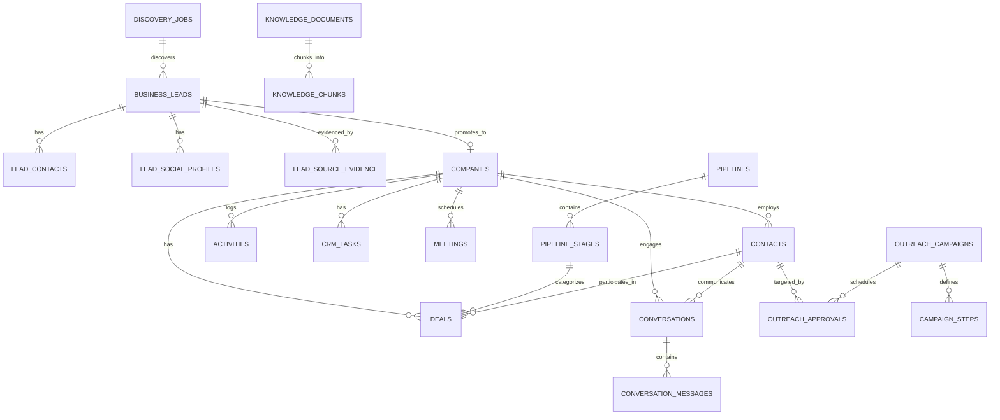

# AI Sales & CRM Operating System — Database Schema

## 1. Schema Overview

The database layer is built using **SQLAlchemy 2.0 declarative models** designed with dialect independence. It runs seamlessly on **PostgreSQL 16** (production deployment with connection pooling) and **SQLite** (local development and test automation).

To achieve dialect independence without runtime errors, all primary and foreign key identifiers use a custom platform-independent `GUID` type decorator (`backend/app/models/guid.py`). In PostgreSQL, this renders as the native `UUID` type; in SQLite, it renders as `CHAR(36)` while automatically serializing and deserializing Python `uuid.UUID` objects.

---

## 2. Entity-Relationship Diagram (ERD)



---

## 3. Detailed Table Inventory & Field Specifications

### 3.1. Lead Discovery Engine Tables

#### `discovery_jobs`
Tracks batch lead discovery operations across Google Maps, SerpAPI, Apify, and direct search crawls.
| Column | Type | Constraints | Description |
| :--- | :--- | :--- | :--- |
| `id` | `GUID` | PK | Unique job identifier |
| `query` | `VARCHAR(255)` | NOT NULL | Search keyword or prompt (e.g. "plumbers") |
| `location` | `VARCHAR(255)` | NOT NULL | Targeted geographic location (e.g. "Austin, TX") |
| `latitude` | `FLOAT` | NULLABLE | Center geographic latitude for radial scanning |
| `longitude` | `FLOAT` | NULLABLE | Center geographic longitude for radial scanning |
| `radius_km` | `FLOAT` | DEFAULT 10.0 | Search radius in kilometers |
| `max_results` | `INTEGER` | DEFAULT 50 | Target lead yield |
| `status` | `VARCHAR(50)` | DEFAULT 'pending' | `pending`, `running`, `completed`, `failed` |
| `total_found` | `INTEGER` | DEFAULT 0 | Count of unique leads identified |
| `error_message` | `TEXT` | NULLABLE | Error message if discovery failed |
| `created_at` | `TIMESTAMP` | DEFAULT utcnow | Job submission timestamp |
| `completed_at`| `TIMESTAMP` | NULLABLE | Job termination timestamp |

#### `business_leads`
Core discovered prospect entity. Holds raw discovery metadata, contact info, qualification score, and AI research dossiers.
| Column | Type | Constraints | Description |
| :--- | :--- | :--- | :--- |
| `id` | `GUID` | PK | Unique lead identifier |
| `job_id` | `GUID` | FK -> `discovery_jobs.id` (CASCADE) | Parent discovery job |
| `name` | `VARCHAR(255)` | NOT NULL, INDEX | Commercial business name |
| `normalized_name`| `VARCHAR(255)` | NOT NULL, INDEX | Lowercased, alphanumeric normalized name for deduplication |
| `category` | `VARCHAR(100)` | NULLABLE | Industry / business classification |
| `address` | `TEXT` | NULLABLE | Full physical or postal address |
| `city` | `VARCHAR(100)` | NULLABLE, INDEX | City |
| `state` | `VARCHAR(100)` | NULLABLE | State / Province |
| `country` | `VARCHAR(100)` | DEFAULT 'India' | Country |
| `postal_code` | `VARCHAR(20)` | NULLABLE | Postal code |
| `latitude` | `FLOAT` | NULLABLE | Verified geographic latitude |
| `longitude` | `FLOAT` | NULLABLE | Verified geographic longitude |
| `phone` | `VARCHAR(50)` | NULLABLE | Primary normalized phone number |
| `website` | `VARCHAR(500)` | NULLABLE | Commercial website URL |
| `rating` | `FLOAT` | NULLABLE | Public review rating (e.g. 4.8) |
| `reviews_count` | `INTEGER` | DEFAULT 0 | Total volume of public reviews |
| `status` | `VARCHAR(50)` | DEFAULT 'new' | Pipeline status (`new`, `contacted`, `converted`) |
| `source` | `VARCHAR(50)` | DEFAULT 'google_maps' | Discovery source channel |
| `source_url` | `TEXT` | NULLABLE | Direct URL to original directory entry |
| `company_id` | `GUID` | FK -> `companies.id` (SET NULL) | Linked CRM Company if converted |
| `qualification_score` | `FLOAT` | DEFAULT 0.0, INDEX | Computed ICP fit score (0.0 – 100.0) |
| `qualification_status`| `VARCHAR(50)` | DEFAULT 'New' | `New`, `Researching`, `Qualified`, `Maybe`, `Rejected` |
| `qualification_reasoning`| `TEXT` | NULLABLE | Human-readable explanation of score |
| `qualification_breakdown`| `JSON` | NULLABLE | 5-factor scoring weights and partial scores |
| `company_research` | `JSON` | NULLABLE | Structured dossier (`verified_facts`, `inferred_insights`, `unknowns`) |
| `created_at` | `TIMESTAMP` | DEFAULT utcnow | Ingestion timestamp |
| `updated_at` | `TIMESTAMP` | DEFAULT utcnow | Last modification timestamp |

#### `lead_contacts`
Extracted email addresses and telephone numbers associated with a `business_lead`.
| Column | Type | Constraints | Description |
| :--- | :--- | :--- | :--- |
| `id` | `GUID` | PK | Unique contact extract identifier |
| `lead_id` | `GUID` | FK -> `business_leads.id` (CASCADE) | Associated lead |
| `type` | `VARCHAR(20)` | NOT NULL | `email` or `phone` |
| `value` | `VARCHAR(255)` | NOT NULL, INDEX | Normalized email address or E.164 phone |
| `is_verified`| `BOOLEAN` | DEFAULT False | DNS MX verified or active carrier check |
| `source_url` | `VARCHAR(500)` | NULLABLE | Crawled page URL where contact was scraped |
| `confidence` | `FLOAT` | DEFAULT 1.0 | Extraction confidence score (0.0 to 1.0) |
| `created_at` | `TIMESTAMP` | DEFAULT utcnow | Extraction timestamp |

#### `lead_social_profiles`
Social media and professional presence links extracted during enrichment.
| Column | Type | Constraints | Description |
| :--- | :--- | :--- | :--- |
| `id` | `GUID` | PK | Unique profile identifier |
| `lead_id` | `GUID` | FK -> `business_leads.id` (CASCADE) | Associated lead |
| `platform` | `VARCHAR(50)` | NOT NULL | `linkedin`, `twitter`, `instagram`, `facebook`, `youtube`, `github` |
| `url` | `VARCHAR(500)` | NOT NULL | Canonical profile URL |
| `username` | `VARCHAR(100)` | NULLABLE | Scraped account handle |
| `created_at` | `TIMESTAMP` | DEFAULT utcnow | Extraction timestamp |

#### `lead_source_evidence`
Audit trail of raw HTML pages, HTTP response headers, and directory entries verifying lead data.
| Column | Type | Constraints | Description |
| :--- | :--- | :--- | :--- |
| `id` | `GUID` | PK | Unique evidence record identifier |
| `lead_id` | `GUID` | FK -> `business_leads.id` (CASCADE) | Associated lead |
| `source_type` | `VARCHAR(50)` | NOT NULL | `website`, `google_maps`, `directory`, `csv` |
| `url` | `TEXT` | NOT NULL | Source URL |
| `raw_data` | `TEXT` | NULLABLE | Raw HTML or JSON payload snippet |
| `extracted_fields`| `TEXT` | NULLABLE | JSON string of fields extracted from this source |
| `created_at` | `TIMESTAMP` | DEFAULT utcnow | Ingestion timestamp |

---

### 3.2. Full CRM Engine Tables

#### `companies`
Account record representing an organization in the active sales pipeline.
| Column | Type | Constraints | Description |
| :--- | :--- | :--- | :--- |
| `id` | `GUID` | PK | Unique company identifier |
| `name` | `VARCHAR(255)` | NOT NULL, INDEX | Registered or trading company name |
| `domain` | `VARCHAR(255)` | NULLABLE, INDEX | Primary corporate web domain |
| `industry` | `VARCHAR(100)` | NULLABLE | Industry vertical |
| `size_range` | `VARCHAR(50)` | NULLABLE | Team size (e.g. "1-10", "11-50", "51-200") |
| `website` | `VARCHAR(500)` | NULLABLE | Full website address |
| `phone` | `VARCHAR(50)` | NULLABLE | Corporate switchboard or primary phone |
| `address` | `TEXT` | NULLABLE | Physical headquarters address |
| `city` | `VARCHAR(100)` | NULLABLE | City |
| `country` | `VARCHAR(100)` | DEFAULT 'India' | Country |
| `lead_id` | `GUID` | FK -> `business_leads.id` (SET NULL) | Discovered lead origin |
| `overview` | `TEXT` | NULLABLE | Executive company summary |
| `tech_stack` | `JSON` | NULLABLE | Array of identified software/technologies |
| `created_at` | `TIMESTAMP` | DEFAULT utcnow | Creation timestamp |
| `updated_at` | `TIMESTAMP` | DEFAULT utcnow | Modification timestamp |

#### `contacts`
Individual contact persons, decision-makers, and influencers within a `Company`.
| Column | Type | Constraints | Description |
| :--- | :--- | :--- | :--- |
| `id` | `GUID` | PK | Unique contact identifier |
| `company_id` | `GUID` | FK -> `companies.id` (CASCADE) | Associated employer account |
| `first_name` | `VARCHAR(100)` | NOT NULL | Given name |
| `last_name` | `VARCHAR(100)` | NULLABLE | Family name |
| `job_title` | `VARCHAR(150)` | NULLABLE | Corporate job title (e.g. "Managing Director") |
| `email` | `VARCHAR(255)` | NULLABLE, INDEX | Work email address |
| `phone` | `VARCHAR(50)` | NULLABLE | Direct phone or mobile |
| `linkedin_url`| `VARCHAR(500)`| NULLABLE | Professional LinkedIn URL |
| `is_decision_maker`| `BOOLEAN` | DEFAULT False | Evaluated decision-making authority |
| `reachability_status`| `VARCHAR(50)`| DEFAULT 'unverified' | `verified`, `unverified`, `bounced`, `suppressed` |
| `notes` | `TEXT` | NULLABLE | Personal rapport and context notes |
| `created_at` | `TIMESTAMP` | DEFAULT utcnow | Record creation timestamp |
| `updated_at` | `TIMESTAMP` | DEFAULT utcnow | Modification timestamp |

#### `pipelines`
Sales processes and operational funnels (e.g. "Standard Sales Pipeline", "Outbound Partnerships").
| Column | Type | Constraints | Description |
| :--- | :--- | :--- | :--- |
| `id` | `GUID` | PK | Unique pipeline identifier |
| `name` | `VARCHAR(100)` | NOT NULL | Pipeline descriptive name |
| `is_default` | `BOOLEAN` | DEFAULT False | Flag designating the primary default funnel |
| `created_at` | `TIMESTAMP` | DEFAULT utcnow | Creation timestamp |

#### `pipeline_stages`
Configurable stages within a sales pipeline, supporting Kanban board rendering.
| Column | Type | Constraints | Description |
| :--- | :--- | :--- | :--- |
| `id` | `GUID` | PK | Unique stage identifier |
| `pipeline_id` | `GUID` | FK -> `pipelines.id` (CASCADE) | Parent pipeline |
| `name` | `VARCHAR(100)` | NOT NULL | Stage label (`Lead`, `Qualified`, `Proposal`, `Won`) |
| `order_index` | `INTEGER` | DEFAULT 0 | Left-to-right display sequence on Kanban board |
| `probability` | `FLOAT` | DEFAULT 0.0 | Stage win probability (0.0 to 1.0) |
| `created_at` | `TIMESTAMP` | DEFAULT utcnow | Creation timestamp |

#### `deals`
Commercial sales opportunities advancing through pipeline stages.
| Column | Type | Constraints | Description |
| :--- | :--- | :--- | :--- |
| `id` | `GUID` | PK | Unique deal identifier |
| `company_id` | `GUID` | FK -> `companies.id` (CASCADE) | Prospective client organization |
| `contact_id` | `GUID` | FK -> `contacts.id` (SET NULL) | Primary prospect point of contact |
| `stage_id` | `GUID` | FK -> `pipeline_stages.id` | Current position in sales pipeline |
| `title` | `VARCHAR(255)` | NOT NULL | Opportunity title (e.g. "Acme Corp Web Redesign") |
| `amount` | `FLOAT` | DEFAULT 0.0 | Estimated commercial value |
| `currency` | `VARCHAR(10)` | DEFAULT 'USD' | Currency code (`USD`, `INR`, `EUR`) |
| `status` | `VARCHAR(50)` | DEFAULT 'open' | Deal disposition (`open`, `won`, `lost`) |
| `expected_close_date`| `TIMESTAMP` | NULLABLE | Target closing date |
| `created_at` | `TIMESTAMP` | DEFAULT utcnow | Inception timestamp |
| `updated_at` | `TIMESTAMP` | DEFAULT utcnow | Last update timestamp |

#### `activities`
Unified chronological activity timeline across companies, deals, and contacts.
| Column | Type | Constraints | Description |
| :--- | :--- | :--- | :--- |
| `id` | `GUID` | PK | Unique activity identifier |
| `company_id` | `GUID` | FK -> `companies.id` (SET NULL) | Associated company |
| `deal_id` | `GUID` | FK -> `deals.id` (SET NULL) | Associated deal |
| `contact_id` | `GUID` | FK -> `contacts.id` (SET NULL) | Associated contact |
| `activity_type`| `VARCHAR(50)` | NOT NULL | `note`, `call`, `email`, `meeting`, `status_change` |
| `subject` | `VARCHAR(255)` | NOT NULL | Brief summary heading |
| `description` | `TEXT` | NULLABLE | Detailed body notes |
| `created_at` | `TIMESTAMP` | DEFAULT utcnow | Record timestamp |

#### `crm_tasks`
Action items and operational to-dos assigned to deals or companies.
| Column | Type | Constraints | Description |
| :--- | :--- | :--- | :--- |
| `id` | `GUID` | PK | Unique task identifier |
| `company_id` | `GUID` | FK -> `companies.id` (SET NULL) | Context company |
| `deal_id` | `GUID` | FK -> `deals.id` (SET NULL) | Context deal |
| `title` | `VARCHAR(255)` | NOT NULL | Action item description |
| `priority` | `VARCHAR(20)` | DEFAULT 'medium' | `low`, `medium`, `high`, `urgent` |
| `due_date` | `TIMESTAMP` | NULLABLE | Deadline timestamp |
| `is_completed`| `BOOLEAN` | DEFAULT False | Completion status |
| `created_at` | `TIMESTAMP` | DEFAULT utcnow | Creation timestamp |

#### `meetings`
Calendar calls, discovery sessions, and demos with automated AI briefing notes.
| Column | Type | Constraints | Description |
| :--- | :--- | :--- | :--- |
| `id` | `GUID` | PK | Unique meeting identifier |
| `company_id` | `GUID` | FK -> `companies.id` (CASCADE) | Prospect account |
| `contact_id` | `GUID` | FK -> `contacts.id` (SET NULL) | Meeting attendee |
| `title` | `VARCHAR(255)` | NOT NULL | Meeting title |
| `scheduled_at`| `TIMESTAMP` | NOT NULL | Scheduled appointment time |
| `duration_minutes`| `INTEGER` | DEFAULT 30 | Scheduled duration |
| `location_url`| `VARCHAR(500)` | NULLABLE | Google Meet, Zoom, or office location |
| `briefing_notes`| `TEXT` | NULLABLE | AI-generated pre-meeting cheat-sheet |
| `status` | `VARCHAR(50)` | DEFAULT 'scheduled' | `scheduled`, `completed`, `cancelled`, `no_show` |
| `created_at` | `TIMESTAMP` | DEFAULT utcnow | Creation timestamp |

---

### 3.3. AI Outreach, Governance & Conversations

#### `outreach_campaigns`
Multi-step cadence campaigns spanning email and messaging channels.
| Column | Type | Constraints | Description |
| :--- | :--- | :--- | :--- |
| `id` | `GUID` | PK | Unique campaign identifier |
| `name` | `VARCHAR(255)` | NOT NULL | Campaign name |
| `channel` | `VARCHAR(50)` | DEFAULT 'email' | Primary medium (`email`, `whatsapp`, `multichannel`) |
| `status` | `VARCHAR(50)` | DEFAULT 'draft' | `draft`, `active`, `paused`, `completed` |
| `daily_limit` | `INTEGER` | DEFAULT 50 | Daily dispatch volume cap |
| `created_at` | `TIMESTAMP` | DEFAULT utcnow | Creation timestamp |

#### `campaign_steps`
Ordered touchpoints in a sequential outreach campaign.
| Column | Type | Constraints | Description |
| :--- | :--- | :--- | :--- |
| `id` | `GUID` | PK | Unique step identifier |
| `campaign_id` | `GUID` | FK -> `outreach_campaigns.id` (CASCADE) | Parent campaign |
| `step_number` | `INTEGER` | NOT NULL | Step order sequence (1, 2, 3...) |
| `delay_days` | `INTEGER` | DEFAULT 2 | Waiting interval after previous touchpoint |
| `subject_template`| `VARCHAR(255)`| NULLABLE | Subject line template with tokens |
| `body_template` | `TEXT` | NOT NULL | Message template with tokens |

#### `outreach_approvals` (Human Approval Queue)
The mandatory governance gatekeeper through which all outbound communications must pass.
| Column | Type | Constraints | Description |
| :--- | :--- | :--- | :--- |
| `id` | `GUID` | PK | Unique approval queue entry identifier |
| `campaign_id` | `GUID` | FK -> `outreach_campaigns.id` (SET NULL) | Associated campaign (if part of sequence) |
| `contact_id` | `GUID` | FK -> `contacts.id` (CASCADE) | Recipient contact record |
| `channel` | `VARCHAR(50)` | NOT NULL | `email` or `whatsapp` |
| `recipient_address`| `VARCHAR(255)`| NOT NULL | Target email address or phone number |
| `subject` | `VARCHAR(255)` | NULLABLE | Outbound subject line (email only) |
| `body_content`| `TEXT` | NOT NULL | Complete proposed message text |
| `status` | `VARCHAR(50)` | DEFAULT 'pending', INDEX | `pending`, `approved`, `rejected`, `sent`, `failed` |
| `rejection_reason`| `TEXT` | NULLABLE | Operator feedback explaining why draft was rejected |
| `reviewed_at` | `TIMESTAMP` | NULLABLE | Timestamp operator made approval decision |
| `sent_at` | `TIMESTAMP` | NULLABLE | Timestamp message was dispatched to provider |
| `created_at` | `TIMESTAMP` | DEFAULT utcnow | Queue creation timestamp |

#### `conversations`
Threaded interaction threads connecting a contact or company across communication channels.
| Column | Type | Constraints | Description |
| :--- | :--- | :--- | :--- |
| `id` | `GUID` | PK | Unique conversation identifier |
| `contact_id` | `GUID` | FK -> `contacts.id` (CASCADE) | Interlocutor contact |
| `company_id` | `GUID` | FK -> `companies.id` (SET NULL) | Interlocutor company |
| `channel` | `VARCHAR(50)` | NOT NULL | `email` or `whatsapp` |
| `thread_id` | `VARCHAR(255)` | NULLABLE, INDEX | External thread ID (Gmail thread or WhatsApp phone) |
| `subject` | `VARCHAR(255)` | NULLABLE | Conversation subject heading |
| `status` | `VARCHAR(50)` | DEFAULT 'active' | `active`, `archived`, `closed` |
| `last_message_at`| `TIMESTAMP` | DEFAULT utcnow | Timestamp of newest message |
| `created_at` | `TIMESTAMP` | DEFAULT utcnow | Thread inception timestamp |

#### `conversation_messages`
Individual incoming or outgoing messages in a thread.
| Column | Type | Constraints | Description |
| :--- | :--- | :--- | :--- |
| `id` | `GUID` | PK | Unique message identifier |
| `conversation_id`| `GUID` | FK -> `conversations.id` (CASCADE) | Parent conversation thread |
| `direction` | `VARCHAR(20)` | NOT NULL | `inbound` or `outbound` |
| `sender` | `VARCHAR(255)` | NOT NULL | Sender address or phone number |
| `recipient` | `VARCHAR(255)` | NOT NULL | Recipient address or phone number |
| `content` | `TEXT` | NOT NULL | Complete raw body text |
| `external_id` | `VARCHAR(255)` | NULLABLE | Provider message ID (Gmail message ID, WhatsApp wamid) |
| `intent` | `VARCHAR(50)` | NULLABLE | AI classified intent (`INTERESTED`, `OBJECTION`, `UNSUBSCRIBE`) |
| `created_at` | `TIMESTAMP` | DEFAULT utcnow | Dispatch or receipt timestamp |

#### `suppression_records`
Global do-not-contact suppression list enforced before any communication can be staged or sent.
| Column | Type | Constraints | Description |
| :--- | :--- | :--- | :--- |
| `id` | `GUID` | PK | Unique suppression entry identifier |
| `identifier` | `VARCHAR(255)` | NOT NULL, UNIQUE, INDEX | Suppressed email address or E.164 phone number |
| `reason` | `VARCHAR(100)` | NOT NULL | `unsubscribe`, `bounce`, `spam_complaint`, `manual_opt_out` |
| `source` | `VARCHAR(100)` | DEFAULT 'user_request' | Source of opt-out signal (webhook keyword, header, user) |
| `created_at` | `TIMESTAMP` | DEFAULT utcnow | Suppression enforcement timestamp |

---

### 3.4. AI Orchestration, Knowledge Base & Telemetry

#### `agent_runs`
Telemetry log recording all executions, token counts, tool calls, and latencies across the 15 AI agents.
| Column | Type | Constraints | Description |
| :--- | :--- | :--- | :--- |
| `id` | `GUID` | PK | Unique run identifier |
| `agent_name` | `VARCHAR(100)` | NOT NULL, INDEX | Agent specialty name (e.g. `lead_qualification_agent`) |
| `provider_used`| `VARCHAR(50)` | NOT NULL | `gemini`, `openrouter`, or `heuristic` |
| `model_name` | `VARCHAR(100)` | NULLABLE | Exact model version executed |
| `input_prompt` | `TEXT` | NOT NULL | User or orchestrator prompt payload |
| `output_response`| `TEXT` | NOT NULL | Agent response or structured JSON string |
| `tools_called` | `JSON` | NULLABLE | Array of tool names and invocation arguments |
| `execution_time_ms`| `FLOAT` | DEFAULT 0.0 | Total duration in milliseconds |
| `status` | `VARCHAR(50)` | DEFAULT 'success' | `success`, `error`, `fallback` |
| `error_message`| `TEXT` | NULLABLE | Error message if execution faulted |
| `created_at` | `TIMESTAMP` | DEFAULT utcnow | Execution timestamp |

#### `knowledge_documents`
Source documents ingested for Retrieval-Augmented Generation (RAG).
| Column | Type | Constraints | Description |
| :--- | :--- | :--- | :--- |
| `id` | `GUID` | PK | Unique document identifier |
| `title` | `VARCHAR(255)` | NOT NULL | Document title (e.g. "Agency Enterprise Offerings") |
| `doc_type` | `VARCHAR(50)` | DEFAULT 'general' | `playbook`, `offering`, `case_study`, `script` |
| `content` | `TEXT` | NOT NULL | Full source document content |
| `created_at` | `TIMESTAMP` | DEFAULT utcnow | Ingestion timestamp |

#### `knowledge_chunks`
Segmented passages with precomputed embeddings used for semantic search.
| Column | Type | Constraints | Description |
| :--- | :--- | :--- | :--- |
| `id` | `GUID` | PK | Unique chunk identifier |
| `document_id` | `GUID` | FK -> `knowledge_documents.id` (CASCADE) | Parent source document |
| `chunk_index` | `INTEGER` | NOT NULL | Zero-indexed chunk position in document |
| `chunk_text` | `TEXT` | NOT NULL | 600-character text segment |
| `embedding` | `JSON` | NULLABLE | Precomputed vector representation (128-dim or 768-dim) |
| `created_at` | `TIMESTAMP` | DEFAULT utcnow | Chunk creation timestamp |

#### `memory_records`
Persistent contextual memory entries stored across user and company interactions.
| Column | Type | Constraints | Description |
| :--- | :--- | :--- | :--- |
| `id` | `GUID` | PK | Unique memory identifier |
| `entity_type` | `VARCHAR(50)` | NOT NULL, INDEX | `company`, `contact`, `deal`, `system` |
| `entity_id` | `VARCHAR(100)` | NOT NULL, INDEX | Foreign entity ID or global key |
| `key` | `VARCHAR(100)` | NOT NULL | Attribute key (e.g. `tech_preference`, `decision_timeline`) |
| `value` | `TEXT` | NOT NULL | Learned factual or preference value |
| `confidence` | `FLOAT` | DEFAULT 1.0 | Memory certainty score |
| `created_at` | `TIMESTAMP` | DEFAULT utcnow | Inception timestamp |
| `updated_at` | `TIMESTAMP` | DEFAULT utcnow | Last refresh timestamp |

#### `audit_logs`
Immutable compliance and human oversight log recording manual score changes and critical overrides.
| Column | Type | Constraints | Description |
| :--- | :--- | :--- | :--- |
| `id` | `GUID` | PK | Unique audit entry identifier |
| `entity_type` | `VARCHAR(50)` | NOT NULL, INDEX | Target entity category (e.g. `lead`, `approval`) |
| `entity_id` | `VARCHAR(100)` | NOT NULL, INDEX | Targeted record identifier |
| `action` | `VARCHAR(100)` | NOT NULL | Action executed (e.g. `manual_score_override`, `rejection`) |
| `previous_state`| `JSON` | NULLABLE | State before alteration |
| `new_state` | `JSON` | NULLABLE | State after alteration |
| `user_notes` | `TEXT` | NULLABLE | Explanation provided by the user |
| `created_at` | `TIMESTAMP` | DEFAULT utcnow | Action timestamp |

---

## 4. Migration Architecture

Database revisions are managed using **Alembic**:
1. `backend/alembic/versions/20261102_0000_001_initial.py`: Baseline discovery tables (`discovery_jobs`, `business_leads`, `lead_contacts`, `lead_social_profiles`, `lead_source_evidence`).
2. `backend/alembic/versions/20261103_0000_002_crm_ai_operating_system.py`: Upgrades baseline schema to the full AI Sales & CRM Operating System by creating all 13 CRM, outreach, knowledge, orchestration, and audit tables, and adding qualification/research columns to `business_leads`.

To apply migrations against a live database:
```bash
cd backend
alembic upgrade head
```
