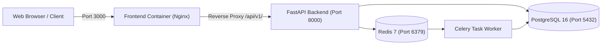

# AI Sales & CRM Operating System — Deployment & Operations Guide

## 1. System Requirements

### Native Execution Requirements
- **Operating System**: Windows 10/11, macOS (Sonoma/Sequoia), or Linux (Ubuntu 22.04+)
- **Python Runtime**: Python 3.11.x (Recommended)
- **Node.js**: Node.js v18.x or v20.x with `npm`
- **Memory**: Minimum 4GB RAM (8GB recommended)
- **Disk**: 2GB free space

### Containerized Deployment Requirements
- **Docker Engine**: Version 24.0+
- **Docker Compose**: Version 2.20+

---

## 2. Option A: Native Local Execution (Quickstart)

Native execution is ideal for personal daily usage and rapid development. In this mode, the backend leverages SQLite (`crm_leads.db`), completely eliminating PostgreSQL or Redis setup prerequisites.

### Step 1: Clone and Configure Environment
```bash
git clone <your-repo-url>
cd MVP
cp .env.example .env
```
*(Open `.env` and configure your API keys for Gemini, SerpAPI, etc., if available. You may leave them empty to run in zero-crash offline heuristic mode).*

---

### Step 2: Backend Setup
1. Create and activate a Python 3.11 virtual environment:
   - **Windows (PowerShell)**:
     ```powershell
     python -m venv backend\venv
     backend\venv\Scripts\Activate.ps1
     ```
   - **Linux / macOS**:
     ```bash
     python3 -m venv backend/venv
     source backend/venv/bin/activate
     ```

2. Install backend dependencies:
   ```bash
   cd backend
   pip install --upgrade pip
   pip install -r requirements.txt
   ```

3. Initialize the database schema:
   ```bash
   alembic upgrade head
   ```

4. Start the FastAPI backend server:
   ```bash
   python main.py
   ```
   *(Backend starts at `http://localhost:8000`. Swagger API docs are viewable at `http://localhost:8000/docs`).*

---

### Step 3: Optional Background Task Worker (Celery)
To execute high-volume multi-page scraping in the background:
1. Ensure a local Redis server is running at `localhost:6379`.
2. In a separate terminal window (with the venv activated):
   - **Windows**:
     ```powershell
     cd backend
     celery -A app.core.celery_app worker --loglevel=info -P solo
     ```
   - **Linux / macOS**:
     ```bash
     cd backend
     celery -A app.core.celery_app worker --loglevel=info --concurrency=2
     ```
*(Note: If Redis is unavailable, synchronous in-process fallback automatically executes requests).*

---

### Step 4: Frontend Setup & Launch
1. Open a new terminal window:
   ```bash
   cd frontend
   npm install
   ```

2. Start the Vite development server:
   ```bash
   npm run dev
   ```
   *(The dashboard opens at `http://localhost:5173`).*

---

## 3. Option B: Production Containerized Deployment (Docker Compose)

The repository provides a production-grade multi-container architecture defined in `docker-compose.yml`:
- `postgres`: PostgreSQL 16 Alpine container with isolated persistent volume.
- `redis`: Redis 7 Alpine cache and message broker.
- `migrate`: Runs Alembic migrations to the latest revision.
- `backend`: FastAPI Uvicorn application server with healthchecks.
- `celery_worker`: Dedicated task worker for background crawling.
- `frontend`: React 18 production bundle served via Nginx on port 3000.



### Deployment Commands

1. **Configure Environment**:
   ```bash
   cp .env.example .env
   # Edit .env with production passwords, SECRET_KEY, and API keys
   ```

2. **Build and Launch All Services**:
   ```bash
   docker compose up -d --build
   ```

3. **Verify Container Health**:
   ```bash
   docker compose ps
   ```
   All services (`crm_leads_postgres`, `crm_leads_redis`, `crm_leads_backend`, `crm_leads_celery_worker`, `crm_leads_frontend`) should display `Up (healthy)`.

4. **Access the Operating System**:
   - Web Application Dashboard: `http://localhost:3000`
   - API & OpenAPI Swagger Docs: `http://localhost:8000/docs`
   - Healthcheck: `http://localhost:8000/health`

---

## 4. Maintenance & Operations

### 4.1. Viewing Real-Time Logs
```bash
# View backend logs
docker compose logs -f backend

# View Celery worker task logs
docker compose logs -f celery_worker
```

### 4.2. Database Backups & Restore
To export a timestamped SQL backup from the production PostgreSQL container:
```bash
docker exec -t crm_leads_postgres pg_dump -U postgres crm_leads > crm_leads_backup_$(date +%Y%m%d).sql
```
To restore a backup:
```bash
cat crm_leads_backup.sql | docker exec -i crm_leads_postgres psql -U postgres -d crm_leads
```

### 4.3. Graceful Shutdown & Upgrades
To stop the application stack cleanly without data loss:
```bash
docker compose down
```
To pull updates and rebuild:
```bash
git pull origin feat/ai-sales-crm-os
docker compose up -d --build
```

