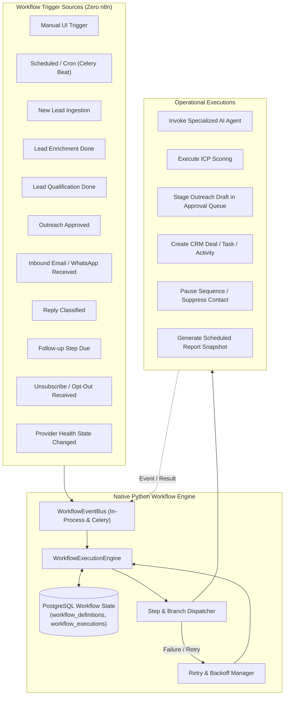

# AI Sales, Lead Generation, Outreach & Marketing Operating System
## Requirement Gap Analysis & Implementation Audit

**Audit Date**: 2026-11-03  
**Auditor**: Senior Software Architect & Autonomous AI Agent  
**Architecture Rule**: **STRICTLY NATIVE PYTHON ARCHITECTURE — ZERO n8n DEPENDENCIES**

---

## 1. Executive Summary of Audit

The Phase 1 implementation established a rock-solid foundation:
- Discovered leads database, contact extraction, and deduplication.
- Centralized provider health management across 11 services.
- Resilient AI router with Google Gemini, OpenRouter, and offline heuristic NLP fallback (0-crash guarantee).
- Relational CRM engine with Companies, Contacts, Deals, Pipelines, Stages, Tasks, and Meetings.
- Mandatory Human Approval Queue for outbound communications and a basic global suppression registry.
- 15 specialized AI agents with scoped tools and multi-step orchestration.
- Hybrid vector/keyword RAG knowledge base.
- Real computed analytics dashboard.
- 15 operational React views with zero compilation errors and 36 passing unit/integration tests.

The **Second-Phase Requirements** expand this system into an enterprise-grade, fully autonomous **AI Sales, Outreach & Email Marketing Operating System** requiring native Python workflow automation (replacing any need for n8n), advanced email deliverability monitoring, 5 distinct campaign types, a 7-check follow-up sequence engine, social media and SEO content marketing, unified inbox reply intelligence with 11 classification categories and automated stop conditions, global consent/retention compliance (GDPR/CAN-SPAM), and daily/weekly/monthly reporting.

---

## 2. Requirement-by-Requirement Gap Analysis

| # | Requirement Module | Existing Implementation | Actual Verified Status | Phase 2 Gap & Remaining Implementation | Priority | Dependencies |
| :--- | :--- | :--- | :--- | :--- | :--- | :--- |
| **1** | **Native Python Workflow Engine (No n8n)** | `AIOrchestrator` runs multi-step agent plans; `Celery` handles async scans | `PARTIAL` | Need a persistent stateful workflow engine: triggers (11 types: manual, schedule, new lead, enrichment done, qualification done, campaign approved, email in, reply classified, follow-up due, unsubscribe, health change), steps, conditional branching, retries, failure handling, cancellation, idempotency, and PostgreSQL execution history. | **P1 (Critical)** | PostgreSQL, Celery/Beat |
| **2** | **Email Deliverability & Mailbox Health** | DNS MX check on extracted leads; `GmailProvider` simulation/live client | `PARTIAL` | Need DNS SPF, DKIM, DMARC monitoring; connected mailbox accounts table with OAuth status, quotas, health state (`HEALTHY`, `WARMING`, `DEGRADED`, `RESTRICTED`); email events (`queued`, `sent`, `delivered`, `bounced`, `complained`); automatic pausing on high bounce (>5%) or complaints; global outbound kill switch. | **P1 (Critical)** | `dnspython`, Database |
| **3** | **Global Consent & Suppression Engine** | `suppression_records` table with email/phone uniqueness check | `PARTIAL` | Need full compliance tracking: `consent_records` (source URL, timestamp, lawful basis: consent / legitimate interest, channel consent, marketing eligibility), data deletion requests (GDPR right to be forgotten), bounce/complaint suppression, and mandatory pre-flight checks before staging outreach. | **P1 (Critical)** | Database, Outreach |
| **4** | **Unified Inbox & Reply Intelligence** | `conversations` & `conversation_messages` with 5 basic intents; UI thread viewer | `PARTIAL` | Expand to full 11 classification categories (`INTERESTED`, `REQUEST_FOR_INFO`, `NOT_NOW`, `REFERRAL`, `MEETING_REQUEST`, `OBJECTION`, `NEGATIVE`, `UNSUBSCRIBE`, `OUT_OF_OFFICE`, `COMPLAINT`, `UNKNOWN`); enforce automatic stop conditions (pause sequences on reply, suppress on unsubscribe/bounce/complaint, auto-create CRM tasks on interested replies, human handoff). | **P1 (Critical)** | AI Router, CRM |
| **5** | **Follow-up & Sequence Engine** | `CampaignStep` model with delay days | `PARTIAL` | Need dedicated `followup_sequences` and `followup_steps` supporting configurable cadences (Day 0, Day 3, Day 7, Day 14); enforce **7 mandatory pre-execution checks** (eligibility, suppression, reply, campaign, approval, provider health, duplicate protection); Celery execution; worker restart recovery. | **P1 (Critical)** | Celery, Suppression |
| **6** | **Campaign Management Engine** | Single `OutreachCampaign` model with draft status | `PARTIAL` | Need 5 distinct campaign types (B2B Prospecting, Newsletters, Nurture, Re-engagement, Inbound Follow-up); campaign member tracking (`campaign_members`); audience segmentation; ICP and exclusion filters; pause/resume/kill switch; performance tracking. | **P2 (Important)** | CRM, Deliverability |
| **7** | **Meeting Scheduling & Sales Handoff** | `Meeting` table with AI briefing notes; manual creation API | `PARTIAL` | Google Calendar integration adapter (simulated when unconfigured); automated meeting request detection from inbound replies; slot retrieval; human-approved booking; calendar event creation; CRM deal/contact association; post-meeting task generation. | **P2 (Important)** | Google OAuth, CRM |
| **8** | **Daily, Weekly, Monthly Reports** | Real-time computed analytics endpoint (`/api/v1/analytics/overview`) | `PARTIAL` | Need scheduled report generator (`report_snapshots` table) computing daily operational summaries, weekly trend analyses, and monthly ROI/pipeline contributions; exportable and viewable in UI. | **P2 (Important)** | Analytics, Celery Beat |
| **9** | **Exception Queue** | Outreach approval rejection notes | `PARTIAL` | Dedicated exception queue UI and API capturing failed steps, unclassified replies, delivery failures, legal uncertainties, and review alerts. | **P2 (Important)** | Workflow Engine |
| **10** | **Social Media & Content Marketing** | Social URL extraction from leads | `MISSING` | Multi-platform planning (LinkedIn, X, Instagram, Facebook, Reddit, Quora); 5 content pillars; topic research; AI drafts; platform-specific formatting; repurposing; calendar scheduling; approval queue; `NOT_CONFIGURED` publishing status. | **P3 (Growth)** | AI Router, Database |
| **11** | **SEO & Inbound Marketing** | Webpage title/meta tag scraping | `MISSING` | Keyword research & clustering; search intent classification; content briefs; service/industry/location page planning; internal link suggestions; meta title/description generator; GSC/GA adapter. | **P3 (Growth)** | AI Router, Database |
| **12** | **Paid Ads & Community Support** | None | `MISSING` | Google Ads / Meta Ads reporting adapter (spend, clicks, attribution); Community research (Reddit/Quora question discovery, draft helpful responses, community rules reminder, human approval). | **P3 (Growth)** | Database |

---

## 3. Detailed Architecture Plan: Python-Native Workflow Automation

---

## 4. Implementation Dependencies & Execution Sequence

```mermaid
flowchart LR
    S1["1. Database Models & Migrations<br/>(Alembic Rev 003)"] --> S2["2. Deliverability & Compliance<br/>(SPF/DKIM, Kill Switch, Consent)"]
    S2 --> S3["3. Reply Intelligence & Sequences<br/>(11 Categories, 7 Checks, Stop Conditions)"]
    S3 --> S4["4. Python Workflow Engine<br/>(EventBus, Triggers, Executions)"]
    S4 --> S5["5. Marketing & Content Modules<br/>(Social, SEO, Paid Ads, Calendar)"]
    S5 --> S6["6. Scheduled Reporting & Analytics<br/>(Daily, Weekly, Monthly Snapshots)"]
    S6 --> S7["7. Frontend UI Expansion<br/>(10 New/Enhanced Views)"]
    S7 --> S8["8. Verification & 13 Documentation Deliverables"]
```

