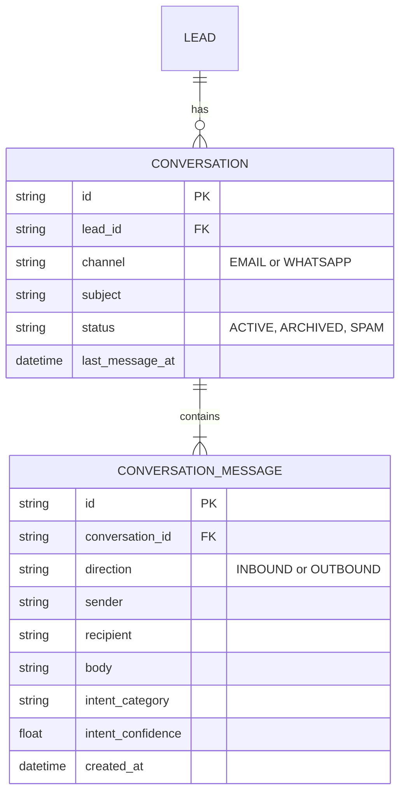

# Unified Inbox & Reply Intelligence Documentation

**System**: AI Sales, Lead Generation, Outreach & Marketing Operating System  
**Module**: `ReplyIntelligenceService`, `Conversation`, and `ConversationMessage`  
**Version**: 2.0.0  

---

## 1. Overview & Objectives

Cold outreach and multi-channel marketing fail when responses are missed, buried in disconnected inboxes, or mishandled by automated sequences that continue emailing a prospect who has already answered.

The **Unified Inbox & Reply Intelligence Engine** solves this by:
1. Aggregating conversations across email (Gmail/SMTP) and WhatsApp into a single chronological timeline.
2. Automatically classifying inbound messages into **11 distinct semantic intent categories** using multi-model AI.
3. Enforcing automated **Stop Conditions** that immediately freeze active sequences when a prospect replies.
4. Auto-routing actionable leads to high-priority CRM tasks and instantly suppressing opted-out leads.

---

## 2. The 11 Reply Intent Classification Categories

Every incoming message ingested through the inbox is analyzed by `ReplyIntelligenceService.classify_reply_intent(message_body)`. The message is tagged with one of 11 intent categories:

| Intent Category | Semantic Definition & Trigger Keywords | Automated System Action |
|:---|:---|:---|
| **1. INTERESTED** | Prospect expresses willingness to learn more, asks for a demo, or shows positive sentiment. *(e.g. "Sounds great, send info", "Tell me more")* | - Pause outreach sequence<br>- Create High-Priority CRM Task<br>- Notify sales operator |
| **2. MEETING_REQUESTED** | Prospect explicitly requests a call, provides calendar availability, or asks for a meeting link. *(e.g. "Let's talk Thursday", "Send your link")* | - Pause outreach sequence<br>- Create Urgent CRM Task<br>- Stage Pre-Meeting Briefing dossier |
| **3. MORE_INFORMATION** | Prospect asks specific technical or pricing questions before deciding. *(e.g. "How much does it cost?", "Do you support HIPAA?")* | - Pause outreach sequence<br>- Stage AI response draft in approvals queue |
| **4. NOT_INTERESTED** | Prospect politely or firmly declines the offer. *(e.g. "Not interested at this time", "We already have a vendor")* | - Pause outreach sequence<br>- Mark Lead Status `NOT_INTERESTED`<br>- Schedule re-engagement in 90 days |
| **5. OUT_OF_OFFICE** | Automated responder indicating the contact is away or on leave. *(e.g. "I am out of the office until Nov 12")* | - Delay next sequence step until return date<br>- **Do not** cancel sequence |
| **6. WRONG_PERSON** | Recipient indicates they are not the appropriate decision-maker. *(e.g. "I don't handle this, talk to Sarah in Marketing")* | - Pause sequence for recipient<br>- Create CRM Task to add referral contact |
| **7. UNSUBSCRIBE** | Explicit request to opt-out or stop emailing. *(e.g. "Unsubscribe", "Remove me from your list")* | - Immediately cancel sequence<br>- Add email to `SuppressionList`<br>- Enforce GDPR compliance record |
| **8. COMPLAINT** | Hostile response, accusations of spam, or threat of legal/regulatory action. *(e.g. "This is illegal spam, I'm reporting you")* | - Immediately cancel sequence<br>- Add domain & email to `SuppressionList`<br>- Create Critical Alert in Exception Queue |
| **9. DO_NOT_CONTACT** | Explicit demand never to reach out across any channel. *(e.g. "Never email or call me again")* | - Immediately cancel sequence<br>- Permanent suppression across all channels<br>- Mark CRM record `DO_NOT_CONTACT` |
| **10. QUESTION** | Clarification inquiry regarding identity or intent. *(e.g. "How did you get my email?", "Who are you?")* | - Pause sequence<br>- Stage compliance origin draft for operator review |
| **11. OTHER** | Uncategorized or ambiguous response requiring human interpretation. | - Pause sequence<br>- Route to operator inbox |

---

## 3. Automated Stop Conditions & State Enforcement

The most critical rule in cold outreach automation is: **Never email someone who has already replied**.

### Sequence Halting Protocol
Whenever an inbound message is received via `POST /api/v1/outreach/conversations/{id}/messages` with `direction="INBOUND"`:
1. **Sequence Lookup**: The system queries `FollowupSequence` for any active sequence tied to `conversation.lead_id`.
2. **Immediate Freeze**: If an active sequence exists, its status is changed from `ACTIVE` to `REPLIED` (or `PAUSED`), and its `next_step_due` timestamp is cleared.
3. **Audit Log**: A `WorkflowEvent` is emitted with event type `REPLY_CLASSIFIED` containing the intent category and confidence score.

### Suppression Enforcement
If the intent is classified as `UNSUBSCRIBE`, `COMPLAINT`, or `DO_NOT_CONTACT`:
1. An entry is created in `SuppressionList` with the recipient's email address and reason.
2. Any pending steps in `outreach_approvals` for this recipient are immediately deleted or marked `REJECTED`.
3. Future enrollment of this lead in any campaign will be blocked by `CampaignEngineService` and `ComplianceService`.

---

## 4. Multi-Channel Conversation Synchronization

The data model cleanly supports omnichannel threading:



### Ingesting an Inbound Message via API
```http
POST /api/v1/outreach/conversations/{conversation_id}/messages
Content-Type: application/json

{
  "direction": "INBOUND",
  "sender": "prospect@targetcompany.com",
  "recipient": "sales@mycompany.com",
  "body": "Hi there, this looks interesting. Can you send over a brief product overview and pricing?",
  "channel": "EMAIL"
}
```

**Response**:
```json
{
  "id": "msg_982348234",
  "conversation_id": "conv_12345",
  "direction": "INBOUND",
  "body": "Hi there, this looks interesting...",
  "intent_category": "INTERESTED",
  "confidence": 0.94,
  "sequence_paused": true,
  "crm_task_created": true
}
```

---

## 5. Human-in-the-Loop Operator Protocols

While AI handles classification and stop conditions automatically, **all outgoing replies require operator approval by default**:
1. When an `INTERESTED` or `MORE_INFORMATION` message arrives, the AI Outreach Copywriter agent drafts a contextual reply citing relevant case studies or pricing.
2. The draft is placed into `outreach_approvals` with type `INBOX_REPLY`.
3. The human operator reviews, edits if necessary, and clicks **Approve & Send** in the Unified Inbox UI.
