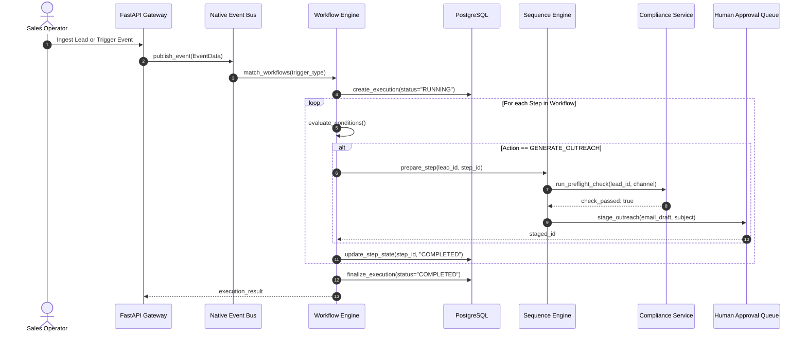
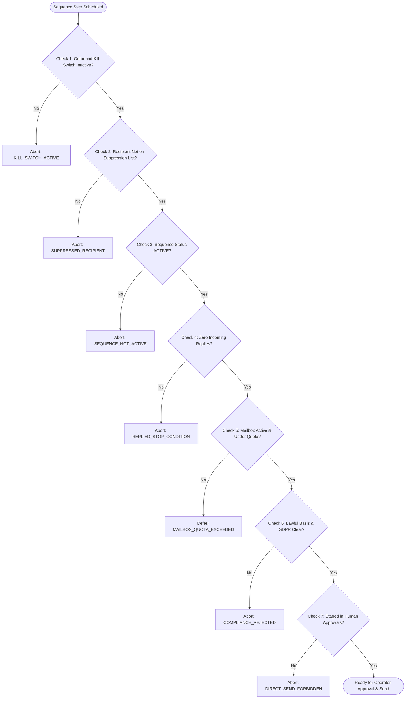

# System Architecture & Technical Specification

**Document Version**: 2.0.0  
**Last Updated**: November 3, 2026  
**System**: AI Sales, Lead Generation, Outreach & Marketing Operating System  
**Architecture Principle**: 100% Native Python Backend, Zero External Workflow Dependencies (Zero n8n)

---

## 1. High-Level Architectural Overview

The application is structured as a modular, five-layer enterprise platform. It operates autonomously to discover leads, orchestrate AI agents, manage sales pipelines, schedule content, and execute outreach sequences, while retaining strict human-in-the-loop controls.

```
+===================================================================================+
|                               1. PRESENTATION LAYER                               |
|       React 18 + TypeScript + Vite + Tailwind CSS + Lucide Icons (Single Page App) |
|                                                                                   |
|  [Discovery]       [CRM & Sales]     [Email & Outreach]  [Automation & Engine]    |
|  - Lead Discovery  - Pipeline / Deals - Unified Inbox     - Workflow Engine (Zero n8n)
|  - Multi-Scanner   - Companies/People - Campaigns (5 Types)- Sequences (7 Checks) |
|  - ICP Profiler    - Tasks / Activities- Deliverability    - Central Exception Queue
|                                                                                   |
|  [Inbound & Content]   [Governance]                                               |
|  - Social Studio       - Compliance / GDPR                                        |
|  - SEO & Briefs        - Approvals Queue                                          |
|  - Calendar / Meetings - Daily/Weekly Reports                                     |
+===================================================================================+
                                         |
                                         | HTTPS / REST / SSE (JSON)
                                         v
+===================================================================================+
|                                2. API & GATEWAY LAYER                             |
|                             FastAPI (Python 3.11+)                                |
|                                                                                   |
|  - /api/v1/leads          - /api/v1/crm            - /api/v1/workflows            |
|  - /api/v1/discovery      - /api/v1/outreach       - /api/v1/deliverability       |
|  - /api/v1/agents         - /api/v1/knowledge      - /api/v1/campaigns            |
|  - /api/v1/integrations   - /api/v1/analytics      - /api/v1/compliance           |
|  - /api/v1/content        - /api/v1/seo            - /api/v1/meetings             |
|  - /api/v1/reports        - /api/v1/exceptions     - /api/v1/sequences            |
+===================================================================================+
                                         |
                                         v
+===================================================================================+
|                              3. CORE APPLICATION SERVICES                         |
|                                                                                   |
|  +------------------------+  +-----------------------+  +----------------------+  |
|  | Native Workflow Engine |  | Deliverability Service|  | Campaign Engine      |  |
|  | - 11 Triggers          |  | - DNS Resolver        |  | - 5 Distinct Types   |  |
|  | - 11 Actions           |  | - Kill Switch         |  | - Member Enrollment |  |
|  | - Branching / Retries  |  | - Mailbox Health/Quota|  | - Audience Segments  |  |
|  +------------------------+  +-----------------------+  +----------------------+  |
|  +------------------------+  +-----------------------+  +----------------------+  |
|  | Sequence Engine        |  | Reply Intelligence    |  | Compliance Service   |  |
|  | - Day 0/3/7/14 Cadence |  | - 11 Intent Classes   |  | - GDPR Erasure (Art17|  |
|  | - 7 Pre-Exec Checks    |  | - Auto-Pause Sequences|  | - Consent Registry   |  |
|  | - Staging in Approvals |  | - Suppression Triggers|  | - Pre-Flight Check   |  |
|  +------------------------+  +-----------------------+  +----------------------+  |
|  +------------------------+  +-----------------------+  +----------------------+  |
|  | Content & SEO Service  |  | Meeting Service       |  | Exception Queue      |  |
|  | - 5 Pillars Repurposing|  | - Google Cal Simulation|  | - Central Error Triag|  |
|  | - Meta / Brief Gen     |  | - Pre-Meeting Dossiers|  | - Severity Ranking   |  |
|  +------------------------+  +-----------------------+  +----------------------+  |
+===================================================================================+
                                         |
                                         v
+===================================================================================+
|                              4. AGENT & PROVIDER LAYER                            |
|                                                                                   |
|  [Multi-Model AI Router]                                                          |
|  - Primary: Google Gemini 1.5 Pro / Flash                                         |
|  - Secondary: OpenRouter (Claude 3.5 Sonnet, GPT-4o, Llama 3)                     |
|  - Offline Fallback: Heuristic AI Provider (Zero external API dependencies)      |
|                                                                                   |
|  [Agent Swarm (15 Specialized Roles)]                                            |
|  - Lead Research, ICP Qualification, Email Copywriting, WhatsApp, Outreach Review |
|  - CRM Data Hygiene, Company Intelligence, SEO Strategy, Content Marketing, etc.  |
|                                                                                   |
|  [External Integration Adapters]                                                  |
|  - Web Scraping: Playwright, BeautifulSoup, Firecrawl, Apify                      |
|  - Search: SerpAPI, DuckDuckGo                                                    |
|  - Messaging: Gmail OAuth/SMTP, WhatsApp Cloud API / Twilio                       |
|  - Calendar: Google Calendar API (w/ simulation fallback)                         |
+===================================================================================+
                                         |
                                         v
+===================================================================================+
|                              5. DATA & PERSISTENCE LAYER                          |
|                                                                                   |
|  [PostgreSQL 16 (Relational DB) / SQLite (Local Test)]                            |
|  - 40+ Models across CRM, Outbound, Workflows, Compliance, Marketing, Analytics   |
|                                                                                   |
|  [Redis 7 (In-Memory Cache & Broker)]                                             |
|  - Celery task broker, rate limiting counters, short-lived session states         |
|                                                                                   |
|  [Celery & Celery Beat (Background Workers)]                                      |
|  - Scheduled workflows, sequence runners, periodic DNS checks, report snapshots  |
+===================================================================================+
```

---

## 2. Zero-n8n Workflow Execution Pipeline

In place of external workflow orchestrators, the system uses an event-driven architecture coupled with Celery and FastAPI background workers.

### Sequence Flow Diagram



---

## 3. The 7 Mandatory Pre-Execution Checks

Prior to any message generation or staging, the `SequenceEngineService` enforces seven independent verification layers. If any single check fails, execution halts immediately:



---

## 4. Database Schema Architecture

The database is managed with **SQLAlchemy 2.0** and **Alembic**. It uses dialect-agnostic constructs (`JSONB` with JSON fallback) for compatibility with both PostgreSQL 16 (production) and SQLite (testing and local single-node mode).

### Table Schema Domain Groups

1. **Core Lead & CRM**:
   - `leads`: Master prospect records, ICP score, qualification data.
   - `companies`: Firmographics, domain, industry, size.
   - `contacts`: Individual person profiles linked to companies.
   - `deals`: Pipeline management, value, stage (`PROSPECTING` -> `WON`).
   - `activities`: Timestamped notes, emails, and phone calls.
   - `crm_tasks`: Action items assigned to operators (e.g. from hot replies).

2. **Native Workflow Engine**:
   - `workflow_definitions`: Blueprints containing step JSON, triggers, and retry configs.
   - `workflow_executions`: Execution records tracking state, start/end times, and execution logs.
   - `workflow_events`: Permanent event stream for triggers.

3. **Deliverability & Inbound Messaging**:
   - `email_domains`: DNS verification records (SPF, DKIM, DMARC, MX) and timestamps.
   - `email_accounts`: Sending mailboxes, daily limits, warmup health states.
   - `email_events`: Transactional logs for sends, opens, clicks, bounces, and complaints.
   - `conversations`: Unified thread across Gmail and WhatsApp.
   - `conversation_messages`: Individual messages with 11-class intent classifications.

4. **Campaigns & Outreach**:
   - `outreach_campaigns`: Campaigns spanning the 5 core archetypes.
   - `campaign_members`: Audience membership with compliance state.
   - `followup_sequences`: Multi-day cadences (Day 0, 3, 7, 14).
   - `followup_steps`: Templates and timing configurations.
   - `outreach_approvals`: Human-in-the-loop review queue for all generated copy.
   - `suppression_list`: Global do-not-contact registry.

5. **Compliance & Privacy**:
   - `consent_records`: Lawful basis tracking per channel.
   - `data_deletion_requests`: Audit trail for GDPR Article 17 "Right to be Forgotten" erasures.

6. **Content, SEO & Marketing**:
   - `content_items`: Repurposed copy across LinkedIn, X, and Reddit.
   - `content_calendar_entries`: Scheduled publishing dates and statuses.
   - `seo_projects`: Domains tracked for organic visibility.
   - `seo_keywords`: Keyword clusters, search volume, intent categorization.
   - `report_snapshots`: Daily, weekly, and monthly aggregate reporting states.

---

## 5. Security & Isolation Architecture

1. **SSRF Mitigation**: Scraper requests validate target URLs against IPv4/IPv6 private ranges (`127.0.0.0/8`, `10.0.0.0/8`, `192.168.0.0/16`, `172.16.0.0/12`) and cloud metadata endpoints (`169.254.169.254`).
2. **Credential Protection**: API keys are injected via environment variables (`.env`). Secrets are never committed to version control.
3. **GDPR Erasure Guarantee**: Data erasure cascades through contacts, leads, notes, and messages, replacing identifying fields with `[ERASED - GDPR ARTICLE 17]` and recording the email in `suppression_list` to prevent re-acquisition.
4. **Offline Capability**: When external LLMs or third-party APIs are unreachable, the system automatically falls back to `HeuristicAIProvider` and simulation adapters without throwing unhandled exceptions.
