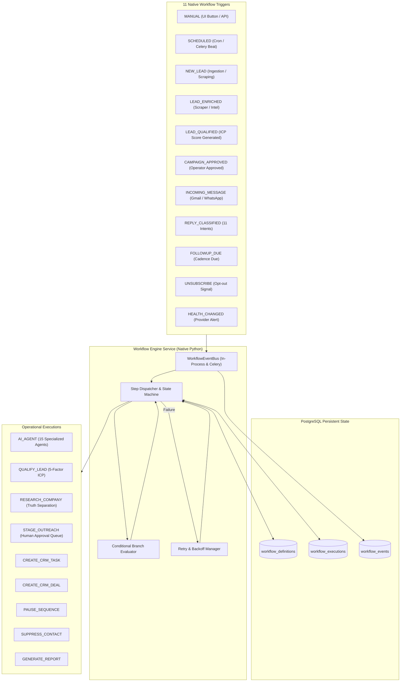

# Native Python Workflow Automation Engine — Technical Documentation

## 1. Architectural Philosophy: Strictly Zero n8n

The AI Sales, Lead Generation, Outreach & Marketing Operating System incorporates an internal, event-driven, stateful workflow automation engine written entirely in native Python (FastAPI, SQLAlchemy 2.0, PostgreSQL, Celery, and Redis). 

> [!IMPORTANT]
> **NO EXTERNAL AUTOMATION DEPENDENCIES**: The platform completely eliminates external workflow tools (such as n8n, Make, or Zapier). All scheduling, trigger monitoring, step dispatching, conditional branching, retry backoffs, and execution state machines are managed natively in Python with persistent PostgreSQL audit history.

---

## 2. Engine Architecture & Dataflow

---

## 3. Workflow Trigger Specifications

| Trigger Type | Fired By | Typical Event Payload | Default Triggered Action |
| :--- | :--- | :--- | :--- |
| `MANUAL` | Operator via UI or API | `{"triggered_by": "operator"}` | Immediate ad-hoc pipeline execution |
| `SCHEDULED` | Celery Beat / Cron | `{"cron_time": "0 8 * * *"}` | Daily reports, due sequence checks |
| `NEW_LEAD` | Lead Scraper / CSV Import | `{"lead_id": "...", "name": "..."}` | Triggers `Auto-Qualify Ingested Leads` |
| `LEAD_ENRICHED` | Firecrawl / Intel Service | `{"lead_id": "...", "tech_stack": [...]}` | Recalculates ICP fit scores |
| `LEAD_QUALIFIED` | Lead Qualification Service | `{"lead_id": "...", "score": 88.5}` | Enrolls into B2B prospecting campaign |
| `CAMPAIGN_APPROVED`| Outreach Approvals View | `{"campaign_id": "..."}` | Activates cadence member sequence |
| `INCOMING_MESSAGE` | Gmail OAuth / WhatsApp Webhook | `{"sender": "...", "body": "..."}` | Dispatches to Reply Classifier |
| `REPLY_CLASSIFIED` | Reply Intelligence Service | `{"classification": "INTERESTED"}` | Creates urgent CRM task and alert |
| `FOLLOWUP_DUE` | Sequence Engine Cadence | `{"sequence_id": "...", "member_id": "..."}` | Stages next touchpoint for approval |
| `UNSUBSCRIBE` | Inbound Reply / Webhook | `{"recipient": "...", "reason": "STOP"}` | Permanent global suppression |
| `HEALTH_CHANGED` | Provider Health Service | `{"provider": "gemini", "status": "DEGRADED"}` | Reroutes to OpenRouter / Heuristic |

---

## 4. Supported Action Types

1. `AI_AGENT`: Invocations of any of the 15 specialized agents via `ToolRegistry`.
2. `QUALIFY_LEAD`: Deterministic & AI evaluation yielding a 0–100 score.
3. `RESEARCH_COMPANY`: Digital footprint ingestion with verified facts vs. inferred insights.
4. `STAGE_OUTREACH`: Inserts personalized email/message into `outreach_approvals` in `PENDING` state (guarantees Human-in-the-Loop).
5. `CREATE_CRM_TASK`: Creates action items with priorities (`low`, `medium`, `high`, `urgent`) and deadlines.
6. `CREATE_CRM_DEAL`: Initiates new opportunities in default or custom sales pipelines.
7. `PAUSE_SEQUENCE`: Halts active sequences upon prospect interaction.
8. `SUPPRESS_CONTACT`: Adds email or phone to `suppression_records`.
9. `GENERATE_REPORT`: Calculates and records daily, weekly, or monthly report snapshots.
10. `CONDITIONAL_BRANCH`: Dynamically checks equality (`==`), threshold (`>=`), or substring (`contains`) against step outputs and routes to `next_step_true` or `next_step_false`.
11. `LOG_ACTIVITY`: Appends an entry to the CRM activity timeline.

---

## 5. Execution State Machine & Resilience

Executions transition through distinct persistent states:
- `PENDING`: Enqueued in PostgreSQL.
- `RUNNING`: Actively processing a step.
- `COMPLETED`: All steps executed successfully.
- `WAITING_FOR_APPROVAL`: Paused at an outreach or sensitive step awaiting operator authorization.
- `RETRYING`: Transient error trapped; exponential backoff active.
- `FAILED`: Fatal exception occurred; logged to Exception Queue with full traceback.
- `CANCELLED`: Manually halted by operator via UI or API.

### Idempotency & Worker Crash Recovery
- Every step result is committed immediately to the `step_results` JSON column in `workflow_executions`.
- If a background worker restarts, uncompleted executions are detected via `status == 'RUNNING'` and resumed from their last successful checkpoint (`current_step_id`), preventing duplicate external actions.

